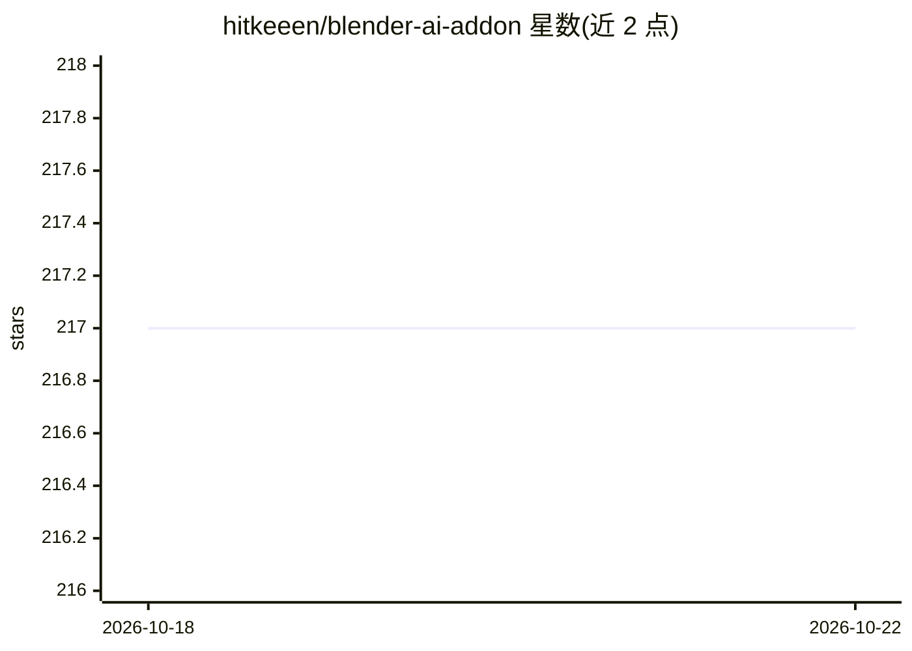

# hitkeeen/blender-ai-addon

⭐ 217 · Python · MIT · 推送 2026-10-09 · [GitHub](https://github.com/hitkeeen/blender-ai-addon) · 个人维护

**通过聊天/图片让 AI 生成 bpy 代码直接改 3D 场景的 Blender 插件**

面向 Blender 用户的 AI 代理插件：在 3D 视口侧边栏以文字或图片描述需求，内置的 OpenCode 代理生成 Python（bpy）代码并由插件自动执行，出错时代理会收到错误日志并自行修复脚本。首次启动时插件自动下载便携版 OpenCode 运行时（约 80MB），不写入系统；支持 OpenAI、OpenRouter、Anthropic、Groq、DeepSeek 及本地 Ollama 等提供方，图片输入需 vision 模型。通过配置文件限制代理权限（禁用 shell、仅可改工作目录文件）。以 Releases zip 或源码打包方式安装。

## 筛选速览

| 维度 | 判定 | 备注 |
|---|---|---|
| AI 角色 | `ai-native` | 本体是模型或模型工具 |
| 许可风险 | `permissive` | MIT |
| 部署形态 | `None` |  |
| 模型依赖 | local-ok | 支持本地模型 |
| 硬件要求 | — | 无带数字的原话,不猜 |
| 安装摩擦 | `low` | 无编译、无系统依赖或容器化 |
| 成熟度 | — | 结构信号不足 |

## 能力要点

- 文字/图片输入 → 自动生成并执行 bpy 代码，出错自动修复（Auto-run + Auto-fix）
- 首次启动自动下载便携版 OpenCode 运行时（约 80MB），无需系统级安装
- 支持 OpenAI/OpenRouter/Anthropic/Groq/DeepSeek/本地 Ollama 六种提供方
- 安全配置：禁用 shell，文件修改仅限工作目录

## 适用场景

- 用自然语言在 Blender 里快速生成或修改 3D 模型
- 用截图或参考图让 AI 按图建模（需 vision 模型）
- 出错时让代理根据错误日志自动修正生成的脚本

## 场景标签

`编码 Agent` `多模态` · 领域:编码与开发

## 证据(README 行号)

> L3: Add-on для Blender, который превращает вьюпорт в чат с **агентом OpenCode**. Опишите словами или покажите картинкой,
> L21: - **Auto-run + Auto-fix** — сгенерированный код выполняется автоматически; при ошибке агент получает лог и чинит ск

## 星数曲线

2026-10-18 217 → 2026-10-22 217（+0）

---
*卡片 v1 · prompt 1.4 · 生成 2026-10-22 · 置信度 high · 依据 README sha `8662d4f1d874` · [字段定义](../../DATASET.md)*
