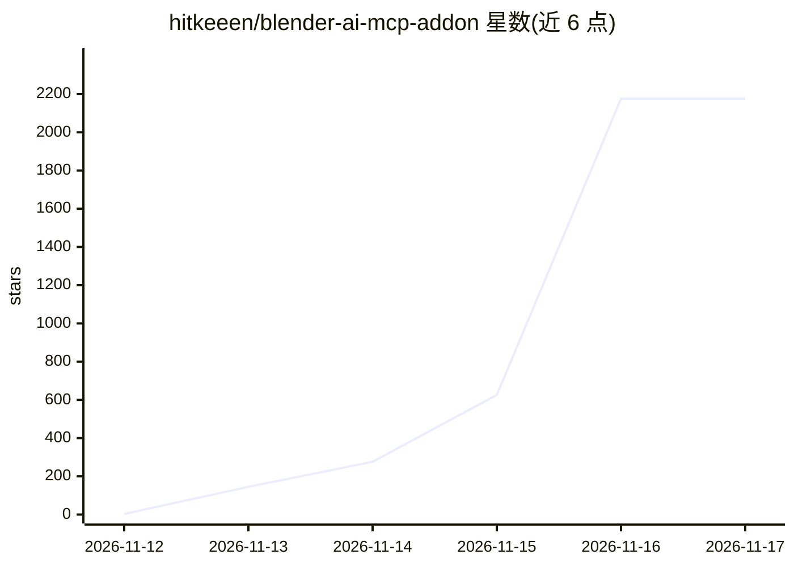

# hitkeeen/blender-ai-mcp-addon

⭐ — · [GitHub]() · 个人维护 · 中文 README

**Blender 的 AI 助手插件：视觉对话、场景工具与内置 MCP 服务器**

面向 Blender 4.2+ 的 AI 插件，提供聊天工作区与场景实时预览、21 种场景工具（检查/创建/编辑/导出/资产检索）、操作审批与撤销。支持连接 OpenAI、Anthropic Claude、Gemini、OpenRouter、Ollama 及自定义端点，可配置 Manager/Workers/Reviewers 多智能体链式任务。内置 MCP 服务器，允许 OpenCode 等 MCP 客户端经认证的本地端点接入。发布包面向 Windows x64，经 Blender 扩展安装器从 ZIP 安装。多语言界面含中文。

## 筛选速览

| 维度 | 判定 | 备注 |
|---|---|---|
| AI 角色 | `ai-enhanced` | 去掉 AI 部分产品仍成立 |
| 许可风险 | `permissive` | — |
| 部署形态 | `desktop` | 安装包/桌面程序 |
| 模型依赖 | local-ok | 支持本地模型 |
| 硬件要求 | — | 无带数字的原话,不猜 |
| 安装摩擦 | `low` | 无编译、无系统依赖或容器化 |
| 成熟度 | — | 结构信号不足 |

## 能力要点

- 21 种场景工具：创建/检查/编辑/截图/资产搜索/导出
- Manager-Workers-Reviewers 多智能体任务链与任务板
- 内置 MCP 服务器，支持认证 Streamable HTTP 接入外部客户端
- 支持 OpenAI/Claude/Gemini/OpenRouter/Ollama/自定义端点，含离线本地模型

## 适用场景

- 用对话让 AI 在 Blender 中搭场景、改材质、排物体
- 技术美术自动化重复性建模与导出工作
- 开发者通过 MCP 将 AI 客户端接入 Blender 做场景自动化

## 场景标签

`AI 助手` `多智能体` · 领域:Agent 开发

## 证据(README 行号)

> L5: **An AI assistant for Blender that can inspect your scene, build objects, edit materials, find assets and carry out 
> L20: **mcp-for-blender-pro brings conversation, scene tools, model choice and agent workflows together.** It is designed

## 星数曲线

2026-11-12 3 → 2026-11-17 2,176（+2,173）

---
*卡片 v1 · prompt 1.4 · 生成 2026-11-17 · 置信度 high · 依据 README sha `4e9f2d889d18` · [字段定义](../../DATASET.md)*
