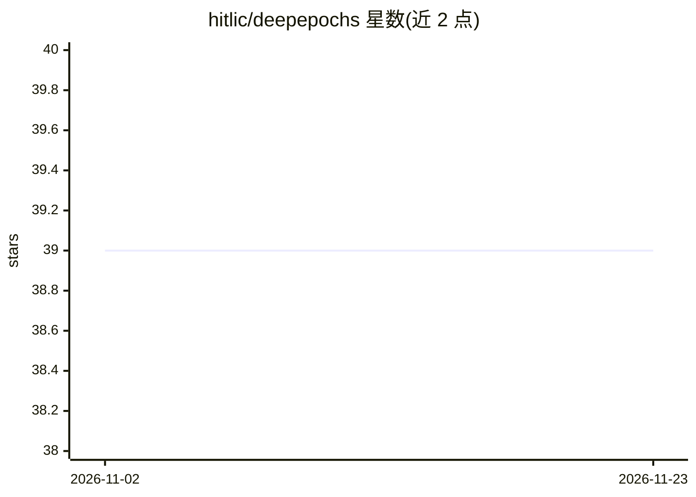

# hitlic/deepepochs

⭐ 39 · Python · MIT · 推送 2026-11-17 · [GitHub](https://github.com/hitlic/deepepochs) · 个人维护 · 中文 README

**PyTorch 模型训练工具：用 Trainer 组织训练验证测试流程**

DeepEpochs 是一个 PyTorch 深度学习模型训练工具：将模型、损失函数、优化器和 DataLoader 交给 `Trainer`，即可执行训练、验证和测试。支持自定义指标、检查点保存与恢复、早停、混合精度、分布式训练、梯度累积、TensorBoard 日志可视化，并可通过 Callback、EpochTask、自定义步骤与 Patch 方式定制训练流程。以 Python 库形式提供，pip 安装；运行要求 Python >= 3.8、PyTorch >= 2.0，仓库含 24 个示例。

## 筛选速览

| 维度 | 判定 | 备注 |
|---|---|---|
| AI 角色 | `ai-ecosystem` | LLM/agent 周边工具 |
| 许可风险 | `permissive` | MIT |
| 部署形态 | `library` | 以包/库形式分发 |
| 模型依赖 | — | README 未给出锁定关系 |
| 硬件要求 | — | 无带数字的原话,不猜 |
| 安装摩擦 | `medium` | 含编译或系统依赖之一 |
| 成熟度 | — | 结构信号不足 |

## 能力要点

- Trainer 组织训练/验证/测试，接受普通 PyTorch 对象
- 支持检查点保存恢复、早停、混合精度与分布式训练
- Callback / EpochTask / Patch 多种定制扩展机制
- 仓库提供 24 个覆盖各功能的示例

## 适用场景

- 训练自己的 PyTorch 模型时省去手写训练循环
- 需要检查点恢复、早停与学习率调度的实验流程
- 使用混合精度与分布式训练加速实验

## 场景标签

`模型训练` · 领域:训练与推理

## 证据(README 行号)

> L3: DeepEpochs 是一个简单的 PyTorch 深度学习模型训练工具。将模型、损失函数、优化器和 DataLoader 交给 `Trainer`，即可执行训练、验证和测试。
> L5: 同时，DeepEpochs 还支持自定义指标、检查点保存与恢复、日志可视化、混合精度与分布式训练等，也可以针对特定任务通过多种方式进行定制。

## 星数曲线

2026-11-02 39 → 2026-11-23 39（+0）

---
*卡片 v1 · prompt 1.4 · 生成 2026-11-18 · 置信度 high · 依据 README sha `72122e1eb956` · [字段定义](../../DATASET.md)*
