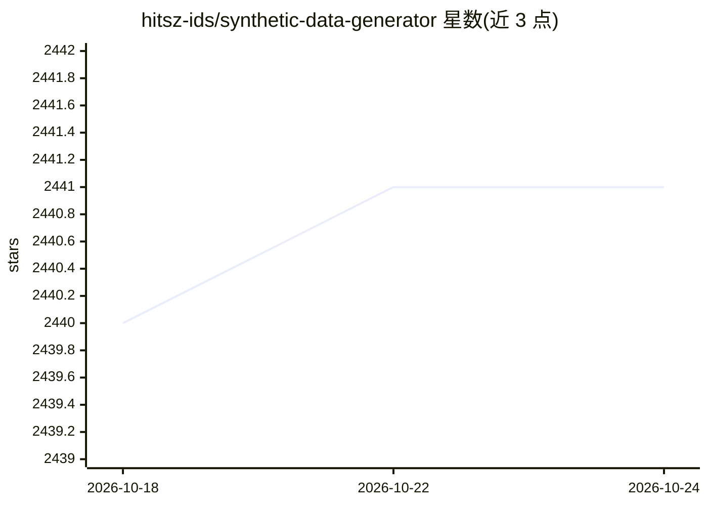

# hitsz-ids/synthetic-data-generator

⭐ 2,441 · Python · Apache-2.0 · 推送 2026-10-19 · [GitHub](https://github.com/hitsz-ids/synthetic-data-generator) · 组织维护 · 中文 README

**为开发者生成结构化表格合成数据的框架，保护隐私**

哈工大数据安全研究院发起的合成数据生成框架：通过 CTGAN、GaussianCopula 等统计/深度模型以及 LLM（SingleTableGPTModel）生成保留原始数据特征但不包含敏感信息的结构化表格数据。内置数据处理器负责列格式转换与空值处理，支持差分隐私、匿名化及插件扩展，优化了大规模数据下的内存占用。提供 docker 镜像、pip 安装与源码安装，含 Colab 示例。

## 筛选速览

| 维度 | 判定 | 备注 |
|---|---|---|
| AI 角色 | `ai-native` | 本体是模型或模型工具 |
| 许可风险 | `permissive` | Apache-2.0 |
| 部署形态 | `self-host` | docker 或自建部署 |
| 模型依赖 | — | README 未给出锁定关系 |
| 硬件要求 | — | 无带数字的原话,不猜 |
| 安装摩擦 | `low` | 无编译、无系统依赖或容器化 |
| 成熟度 | — | 结构信号不足 |

## 能力要点

- 支持 CTGAN、GaussianCopula 等多种表格数据合成模型及 LLM 生成路径
- LLM 可基于元数据在无训练数据时生成合成数据、并做表外特征推断
- 支持差分隐私、匿名化与插件式扩展
- 优化内存占用，CTGAN 支持十亿级数据量

## 适用场景

- 生成不含敏感信息的合成表格数据用于数据共享与模型训练调试
- 在无训练数据时基于元数据用 LLM 生成合成数据
- 系统开发与测试中使用合成数据规避 GDPR/ADPPA 合规风险

## 场景标签

 · 领域:数据合成/隐私计算

## 证据(README 行号)

> L27: The Synthetic Data Generator (SDG) is a specialized framework designed to generate high-quality structured tabular 
> L55: Our `sdgx.models.LLM.single_table.gpt.SingleTableGPTModel` implements two new features:
> L113: from sdgx.models.ml.single_table.ctgan import CTGANSynthesizerModel

## 星数曲线

2026-10-18 2,440 → 2026-10-24 2,441（+1）

---
*卡片 v1 · prompt 1.4 · 生成 2026-10-21 · 置信度 high · 依据 README sha `b08dfbfd85f5` · [字段定义](../../DATASET.md)*
