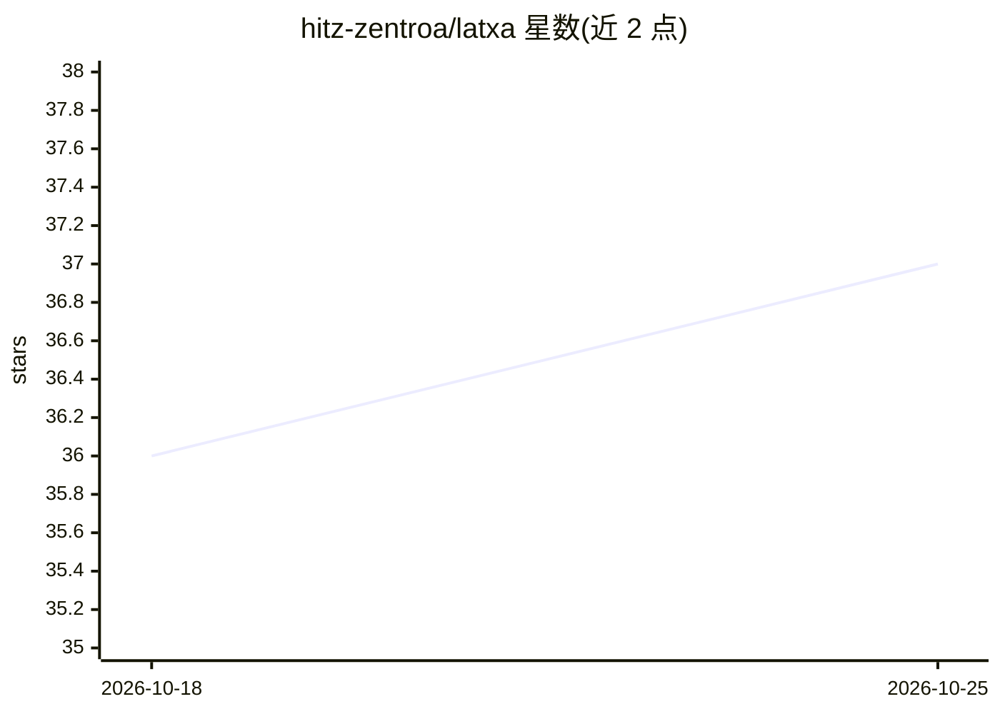

# hitz-zentroa/latxa

⭐ 38 · Shell · MIT · 推送 2025-12-15 · [GitHub](https://github.com/hitz-zentroa/latxa) · 组织维护

**面向巴斯克语的开放大语言模型与评测套件（7B-70B）**

基于 Llama 2 继续预训练的巴斯克语大语言模型家族（7B-70B 参数），预训练语料含 430 万文档、42 亿 token；同时提供 4 个巴斯克语多项选择评测数据集（EusProficiency/EusReading/EusTrivia/EusExams）。模型、语料与评测集均以开放许可公开，托管于 HuggingFace Hub。仓库提供训练代码（GPT-Neox，面向 CINECA Leonardo 集群）与基于 LM Evaluation Harness 的评测脚本，供低资源语言 LLM 的可复现研究使用。

## 筛选速览

| 维度 | 判定 | 备注 |
|---|---|---|
| AI 角色 | `ai-native` | 本体是模型或模型工具 |
| 许可风险 | `permissive` | MIT |
| 部署形态 | `library` | 以包/库形式分发 |
| 模型依赖 | — | README 未给出锁定关系 |
| 硬件要求 | — | 无带数字的原话,不猜 |
| 安装摩擦 | `medium` | 含编译或系统依赖之一 |
| 成熟度 | — | 结构信号不足 |

## 能力要点

- 基于 Llama 2 在 4.2B token 巴斯克语语料上继续预训练，覆盖 7B-70B
- 新增 4 个巴斯克语评测数据集共 2.3 万余题
- 提供 GPT-Neox 训练流程与 LM Evaluation Harness 评测脚本
- 模型、语料与评测集均以开放许可公开发布

## 适用场景

- 获取可直接通过 transformers pipeline 调用的巴斯克语模型
- 研究低资源语言的 LLM 继续预训练方法
- 用巴斯克语基准评测各模型的语言能力

## 场景标签

`模型评测` `模型训练` · 领域:评测与运维

## 证据(README 行号)

> L8: We introduce Latxa, a family of large language models for Basque ranging from 7 to 70 billion parameters. Latxa is b
> L20: pipe = pipeline("text-generation", model="HiTZ/latxa-7b-v1.1")
> L12: - Latxa in the 🤗HuggingFace Hub: HiTZ/latxa

## 星数曲线

2026-10-18 36 → 2026-10-25 37（+1）

---
*卡片 v1 · prompt 1.4 · 生成 2026-10-25 · 置信度 mid · 依据 README sha `69eae225ab5d` · [字段定义](../../DATASET.md)*
