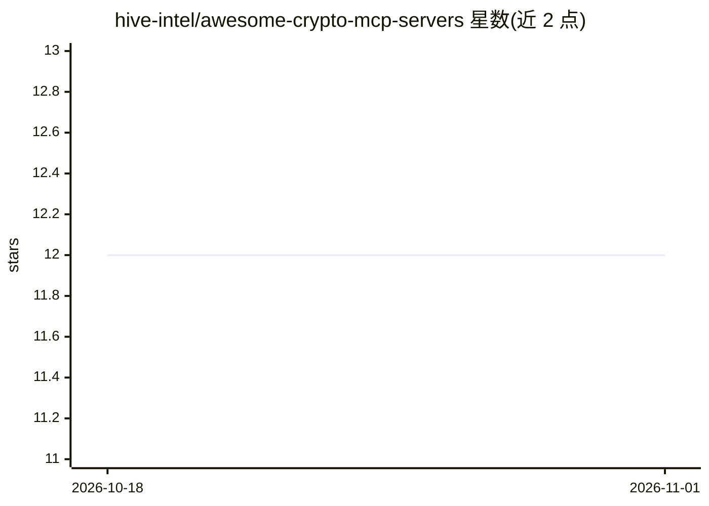

# hive-intel/awesome-crypto-mcp-servers

⭐ 12 · CC0-1.0 · 推送 2026-06-04 · [GitHub](https://github.com/hive-intel/awesome-crypto-mcp-servers) · [官网](https://hiveintelligence.xyz) · 组织维护

**面向 AI agent 的加密货币/Web3 MCP 服务器策展清单**

由 Hive Intelligence 维护的选择性策展清单：收录加密货币、Web3、DeFi、钱包、交易、链上数据等场景的 Model Context Protocol（MCP）服务器，按任务提供快速路由与用例对比，覆盖行情数据、研究信号、钱包操作、交易所 API、支付、风险检测等类别。清单声明处于选择性维护阶段，新条目需满足官方支持、MCP Registry 收录等标准。许可为 CC0-1.0。

## 筛选速览

| 维度 | 判定 | 备注 |
|---|---|---|
| AI 角色 | `ai-knowledge` | 知识聚合/清单类 |
| 许可风险 | `viral` | CC0-1.0 |
| 部署形态 | `library` | 以包/库形式分发 |
| 模型依赖 | — | README 未给出锁定关系 |
| 硬件要求 | — | 无带数字的原话,不猜 |
| 安装摩擦 | `low` | 无编译、无系统依赖或容器化 |
| 成熟度 | — | 结构信号不足 |

## 能力要点

- 按任务场景给出 MCP 服务器快速路由（行情/钱包/交易/支付等）
- 收录标准含官方支持、MCP Registry 收录、安全执行模型
- 声明选择性维护阶段，新条目为例外而非例行添加

## 适用场景

- 为加密交易或研究 agent 挑选合适的行情数据 MCP 服务器
- 查找支持钱包操作与支付的 MCP 服务器
- 对比不同链（Solana/TON/TRON 等）的 MCP 数据源

## 场景标签

`精选清单` · 领域:学习与行业

## 证据(README 行号)

> L3: A curated, maintained list of the best Model Context Protocol servers for crypto, Web3, DeFi, wallets, trading, on-c
> L5: Maintained by Hive Intelligence, the crypto intelligence layer for AI agents. This list is intentionally selective: 

## 星数曲线

2026-10-18 12 → 2026-11-01 12（+0）

---
*卡片 v1 · prompt 1.4 · 生成 2026-11-01 · 置信度 mid · 依据 README sha `125feda0f57a` · [字段定义](../../DATASET.md)*
