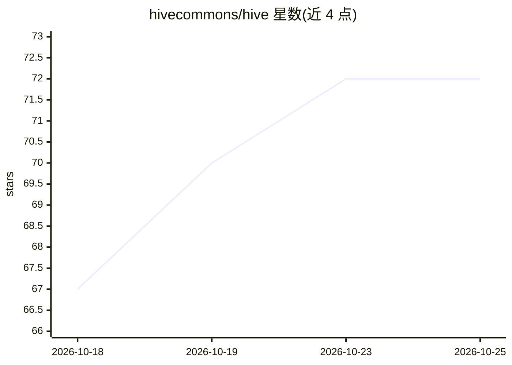

# hivecommons/hive

⭐ 72 · Go · Apache-2.0 · 推送 2026-10-24 · [GitHub](https://github.com/hivecommons/hive) · [官网](https://hive.hivecommons.dev/) · 组织维护

**开源 AI agent 编排系统：自动处理 GitHub 仓库的维护任务**

面向开源项目维护者的 agent 编排平台：监控仓库中的 issue、PR、CI 失败、CVE 与 dependabot 告警，调度短生命周期的 AI 编码 agent（Claude、Copilot、Codex、Antigravity、Goose 或 OpenAI 兼容模型）执行分类、修复、审查与发布。核心机制包括六级 ACMM 信任等级控制 agent 权限、确定性过滤器与门禁、审计日志、任务级短时效 token。采用 hub/spoke 架构，spoke 可运行于 Kubernetes、Podman 或 Docker Compose；另提供 ClankeR 贡献者算力中继。Apache-2.0，另有官方托管的 hub 服务。

## 筛选速览

| 维度 | 判定 | 备注 |
|---|---|---|
| AI 角色 | `ai-ecosystem` | LLM/agent 周边工具 |
| 许可风险 | `permissive` | Apache-2.0 |
| 部署形态 | `self-host` | docker 或自建部署 |
| 模型依赖 | — | README 未给出锁定关系 |
| 硬件要求 | — | 无带数字的原话,不猜 |
| 安装摩擦 | `low` | 无编译、无系统依赖或容器化 |
| 成熟度 | — | 结构信号不足 |

## 能力要点

- 六级 ACMM 信任模型控制 agent 自治程度（仅建议到自动合并）
- 短生命周期 agent + 外部上下文注入 + 确定性模板驱动提示
- hub/spoke 架构，spoke 支持 Kubernetes/Podman/Docker Compose 部署
- ClankeR 贡献者中继：捐算力不共享密钥，任务级短时效 GitHub token

## 适用场景

- 让 AI agent 夜间处理开源仓库的 issue 分类与小修复
- 在保持人工合并决策的前提下自动化 CI 修复与代码审查
- 多人项目汇聚贡献者的算力和模型额度处理积压任务

## 场景标签

`Agent 框架` `多智能体` `编码 Agent` `代码审查` · 领域:Agent 开发

## 证据(README 行号)

> L12: Hive watches the work that piles up in a repository — issues, pull requests, failing CI, CVEs, and dependabot alert
> L49: **Do I need a paid agent subscription?** No. Hive drives the agent CLIs you already have (Claude, Copilot, Codex, A

## 星数曲线

2026-10-18 67 → 2026-10-25 72（+5）

---
*卡片 v1 · prompt 1.4 · 生成 2026-10-24 · 置信度 high · 依据 README sha `d6ce9e1e00d7` · [字段定义](../../DATASET.md)*
