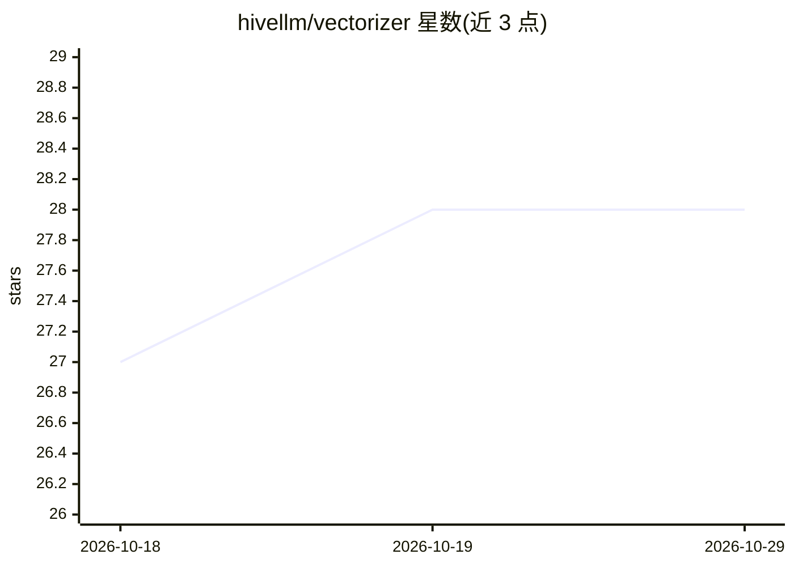

# hivellm/vectorizer

⭐ 28 · Rust · Apache-2.0 · 推送 2026-10-26 · [GitHub](https://github.com/hivellm/vectorizer) · 组织维护

**Rust 内存向量数据库，面向语义搜索与 top-k 近邻查询**

用 Rust 编写的内存向量数据库与搜索引擎，提供二进制 RPC（15503 端口）、REST、gRPC（Qdrant 兼容）、GraphQL 与 MCP（31 个工具）多种访问面。支持 HNSW 索引、SIMD（AVX2）与 Apple Silicon GPU 加速、稠密+稀疏混合搜索、Raft 高可用集群、分布式分片、JWT/API Key 认证与负载加密。内置 TF-IDF/BM25/FastEmbed/BERT 等嵌入提供方，配套 React Web 仪表盘、Electron 桌面 GUI 与 Rust/Python/TypeScript/Go/C# SDK。通过安装脚本、Docker 镜像或源码构建部署。

## 筛选速览

| 维度 | 判定 | 备注 |
|---|---|---|
| AI 角色 | `ai-ecosystem` | LLM/agent 周边工具 |
| 许可风险 | `permissive` | Apache-2.0 |
| 部署形态 | `self-host` | docker 或自建部署 |
| 模型依赖 | — | README 未给出锁定关系 |
| 硬件要求 | — | 无带数字的原话,不猜 |
| 安装摩擦 | `low` | 无编译、无系统依赖或容器化 |
| 成熟度 | — | 结构信号不足 |

## 能力要点

- 多传输协议：二进制 RPC、REST、gRPC、GraphQL、MCP（31 个工具）
- HNSW 索引 + AVX2 SIMD + Apple Silicon Metal GPU 加速
- Raft 共识高可用、主从复制与分布式分片
- 内置多种嵌入提供方与文档转换（PDF/DOCX/图像等 14 格式）

## 适用场景

- 为 AI 应用提供语义搜索与向量检索后端
- 通过 MCP 将向量检索能力接入 Cursor、Claude Desktop 等 AI 客户端
- 以 Qdrant 兼容 API 迁移现有向量检索负载
- 在 Kubernetes 上运行高可用向量数据库集群

## 场景标签

`向量数据库` `语义搜索` · 领域:知识与检索

## 证据(README 行号)

> L10: High-performance vector database and search engine in Rust for semantic search, document indexing, and AI applicati
> L48: - **Built-in providers** — TF-IDF, BM25, FastEmbed, BERT, MiniLM, custom models. **`embedding_provider` (on `POST /

## 星数曲线

2026-10-18 27 → 2026-10-29 28（+1）

---
*卡片 v1 · prompt 1.4 · 生成 2026-10-26 · 置信度 mid · 依据 README sha `88a6644517f8` · [字段定义](../../DATASET.md)*
