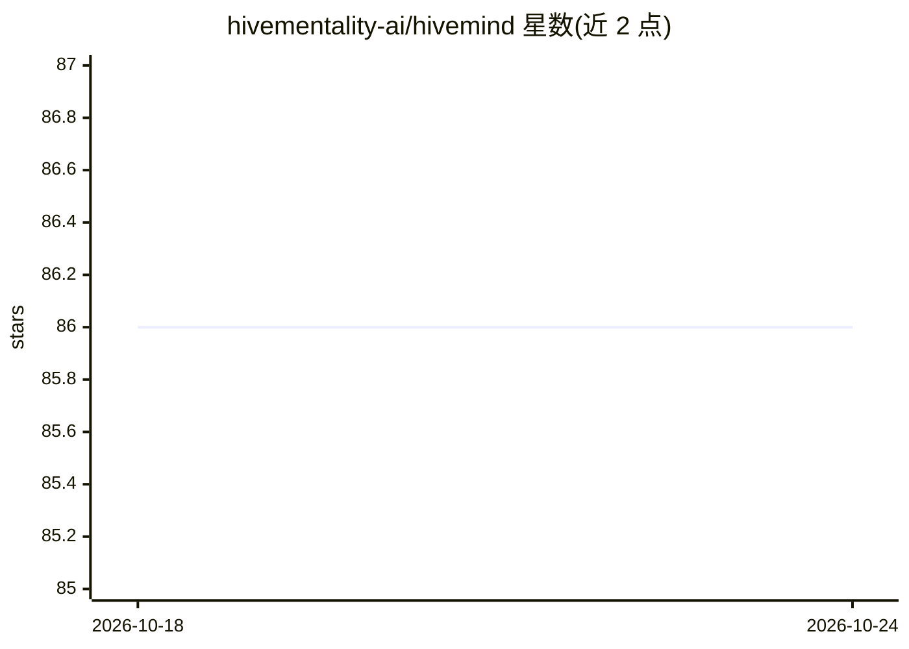

# hivementality-ai/hivemind

⭐ 86 · Ruby · AGPL-3.0 · 推送 2026-09-08 · [GitHub](https://github.com/hivementality-ai/hivemind) · [官网](https://hivementality.ai) · 组织维护

**自托管多智能体 AI 团队平台：沙箱内协作运行 agent 团队**

面向需要多个 AI agent 协同完成实际工作的用户的开源自托管平台。提供 40+ 内置工具（shell、浏览器、Jira、邮件、云存储、MCP 客户端等）、150+ agent 模板、13 个消息渠道集成（Discord/Slack/Telegram 等，每个 agent 有独立 bot 身份）。agent 在容器沙箱内运行，凭据保险库加密（AES-256-GCM），带仅追加审计日志与网络出站控制；支持 agent 运行时自建工具与技能。模型接入支持 Anthropic、OpenAI、Gemini、Ollama 及任意 OpenAI 兼容提供方。通过一键安装脚本或 docker compose 部署，Web 界面配置。

## 筛选速览

| 维度 | 判定 | 备注 |
|---|---|---|
| AI 角色 | `ai-ecosystem` | LLM/agent 周边工具 |
| 许可风险 | `viral` | AGPL-3.0 |
| 部署形态 | `self-host` | docker 或自建部署 |
| 模型依赖 | local-ok | 支持本地模型 |
| 硬件要求 | — | 无带数字的原话,不猜 |
| 安装摩擦 | `low` | 无编译、无系统依赖或容器化 |
| 成熟度 | — | 结构信号不足 |

## 能力要点

- 40+ 内置工具（shell、浏览器、Jira、云存储、MCP 客户端等）
- 13 个消息渠道集成，每个 agent 独立 bot 身份
- 全沙箱运行：零主机访问、凭据保险库加密、仅追加审计日志
- agent 运行时自建工具与技能（自进化）

## 适用场景

- 组建多个专业 AI agent 在沙箱内协作完成实际任务
- 让 AI 团队接入 Slack/Discord 等消息渠道与人类团队协同
- 把多文件编码任务委派给 Claude Code/Codex/Aider 并追踪进度

## 场景标签

`多智能体` `编码 Agent` · 领域:Agent 开发

## 证据(README 行号)

> L40: |:x: You're locked to one AI provider.|:white_check_mark: Any model — Anthropic, OpenAI, Google Gemini, Ollama, any
> L66: - **Any AI model** — Anthropic, OpenAI, Google Gemini, Ollama, any OpenAI-compatible provider. Native extended thin

## 星数曲线

2026-10-18 86 → 2026-10-24 86（+0）

---
*卡片 v1 · prompt 1.4 · 生成 2026-10-24 · 置信度 mid · 依据 README sha `adb6a777fb5b` · [字段定义](../../DATASET.md)*
