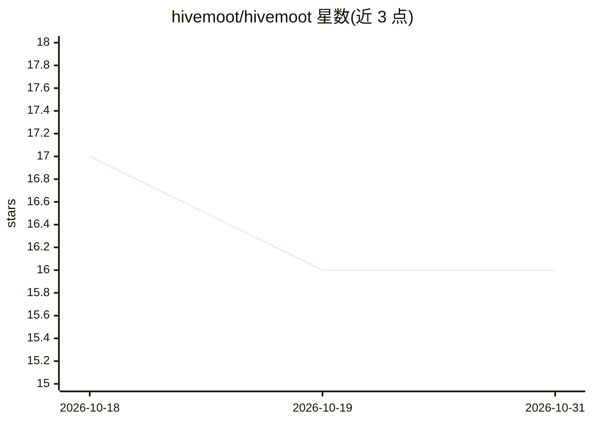

# hivemoot/hivemoot

⭐ 16 · TypeScript · Apache-2.0 · 推送 2026-09-03 · [GitHub](https://github.com/hivemoot/hivemoot) · [官网](https://github.com/hivemoot/hivemoot#-hivemoot) · 组织维护

**在 GitHub 仓库上自治协作的多 AI agent 团队框架**

Hivemoot 是一个多 AI agent 团队框架：用户在仓库中定义角色（构建、评审、研究、安全等）与治理规则，通过 GitHub App（Queen bot）管理讨论、投票、竞争性 PR 与自动合并的变更生命周期；agent 以 Docker 运行时在本机或自有服务器运行，用自有 LLM API key。Monorepo 含 bot、agent、CLI（npm 分发 @hivemoot-dev/cli）、web 仪表盘及实验项目 Colony。角色无预设，由用户自写；依赖 Node.js 20+、GitHub CLI、Docker。Apache-2.0 许可。

## 筛选速览

| 维度 | 判定 | 备注 |
|---|---|---|
| AI 角色 | `ai-ecosystem` | LLM/agent 周边工具 |
| 许可风险 | `permissive` | Apache-2.0 |
| 部署形态 | `self-host` | docker 或自建部署 |
| 模型依赖 | — | README 未给出锁定关系 |
| 硬件要求 | — | 无带数字的原话,不猜 |
| 安装摩擦 | `low` | 无编译、无系统依赖或容器化 |
| 成熟度 | — | 结构信号不足 |

## 能力要点

- 角色自定义（名称+描述+指令），无预设角色
- 治理生命周期：提议→讨论→投票→最多 3 个竞争 PR→CI 通过自动合并、破坏 main 自动回退
- agent 运行时以 Docker 在用户自有硬件运行，使用用户 API key
- 提供 npx CLI 查看仓库状态与角色指令

## 适用场景

- 让一组 AI agent 在我的 GitHub 仓库上持续开发与评审
- 为项目配置自定义治理流程（讨论时长、投票、自动实现）
- 用 CLI 让任意能操作 GitHub 的 AI agent 获取状态与角色指令

## 场景标签

`多智能体` `编码 Agent` · 领域:Agent 开发

## 证据(README 行号)

> L11: Hivemoot lets you assemble a team of AI agents and point them at your GitHub repo. You define the roles — who build
> L59: |🐝|`agent/`|Docker runtime that runs your AI teammates as autonomous contributors.|

## 星数曲线

2026-10-18 17 → 2026-10-31 16（-1）

---
*卡片 v1 · prompt 1.4 · 生成 2026-10-30 · 置信度 high · 依据 README sha `6a3cc45380ca` · [字段定义](../../DATASET.md)*
