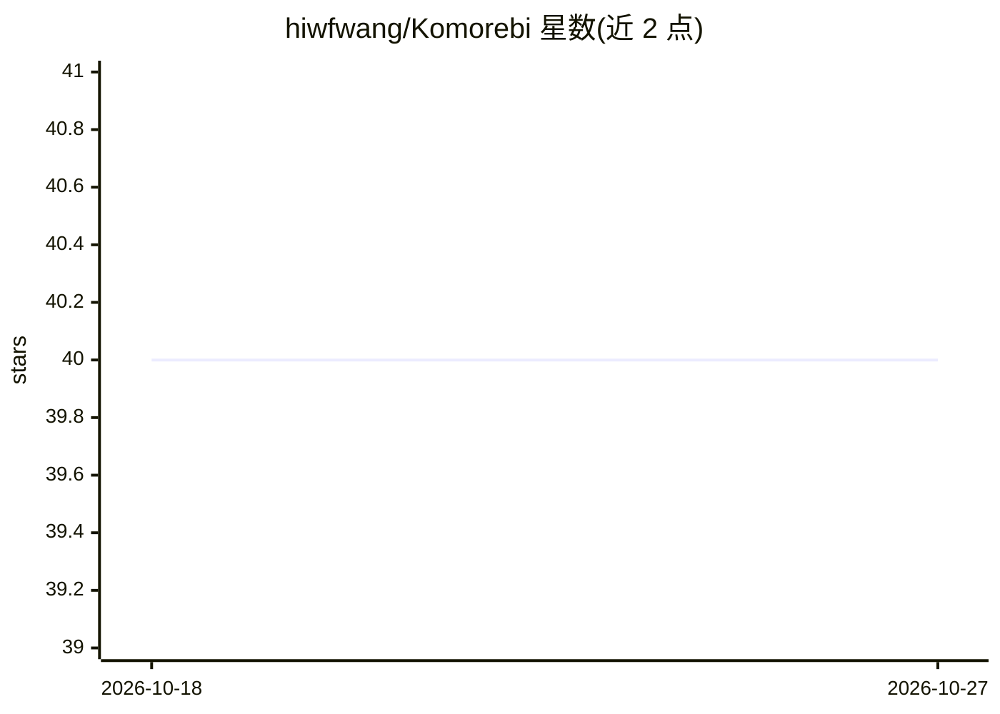

# hiwfwang/Komorebi

⭐ 40 · TypeScript · BSD-3-Clause · 推送 2026-04-24 · [GitHub](https://github.com/hiwfwang/Komorebi) · [官网](https://komorebi-homepage.vercel.app) · 个人维护 · 中文 README

**面向 AI 从业者的桌面 RSS 阅读器，附带可选 AI 功能**

Windows/macOS 桌面 RSS 应用，面向需要追踪 AI 行业动态、新产品与前沿论文的从业者。内置精选 AI 信息源，支持卡片/列表/杂志/紧凑多种阅读视图、未读跟踪、收藏、搜索与文章管理，并针对 YouTube 与社交媒体类内容优化呈现。AI 功能全部可选：用户自带 OpenAI 兼容端点与 API key，可用 AI 搜索、文章摘要、嵌入检索过滤与翻译，并统计 token 用量。网络访问为硬性要求，受限网络环境需代理。

## 筛选速览

| 维度 | 判定 | 备注 |
|---|---|---|
| AI 角色 | `ai-enhanced` | 去掉 AI 部分产品仍成立 |
| 许可风险 | `permissive` | BSD-3-Clause |
| 部署形态 | `desktop` | 安装包/桌面程序 |
| 模型依赖 | — | README 未给出锁定关系 |
| 硬件要求 | — | 无带数字的原话,不猜 |
| 安装摩擦 | `low` | 无编译、无系统依赖或容器化 |
| 成熟度 | — | 结构信号不足 |

## 能力要点

- 内置精选 AI 信息源与上手引导
- AI Search 在指定时间范围与主题内检索并摘要文章
- 可选 AI 功能：用户自带 OpenAI 兼容端点与 API key
- YouTube 字幕获取与基于字幕的摘要工作流

## 适用场景

- 一站式追踪 AI 行业评论、产品发布与论文动态
- 阅读并摘要 YouTube 与社媒类高信息密度来源
- 用嵌入检索过滤与翻译管理 AI 资讯流

## 场景标签

`语义搜索` · 领域:知识与检索

## 证据(README 行号)

> L7: **Komorebi is not a general-purpose RSS reader.**
> L25: - **Optional AI features**: AI-powered workflows are available, but entirely opt-in. Users bring their own API keys
> L59: Komorebi's AI features are optional. To use them, configure your own OpenAI-compatible endpoints, API keys, and mod

## 星数曲线

2026-10-18 40 → 2026-10-27 40（+0）

---
*卡片 v1 · prompt 1.4 · 生成 2026-10-25 · 置信度 high · 依据 README sha `fb1f05ccdb69` · [字段定义](../../DATASET.md)*
