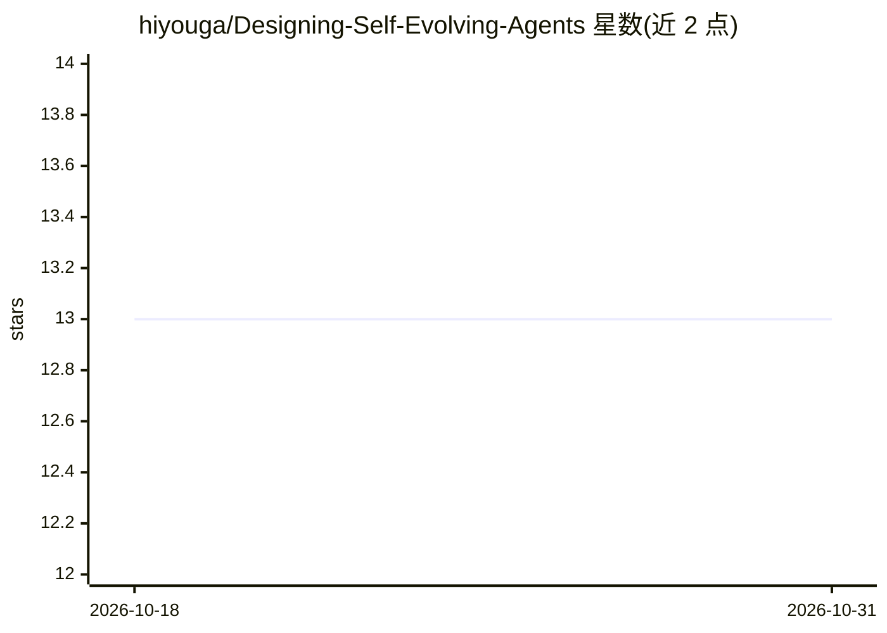

# hiyouga/Designing-Self-Evolving-Agents

⭐ 13 · JavaScript · Apache-2.0 · 推送 2026-09-03 · [GitHub](https://github.com/hiyouga/Designing-Self-Evolving-Agents) · [官网](https://hiyouga.github.io/Designing-Self-Evolving-Agents/) · 个人维护 · 中文 README

**关于设计自进化 LLM Agent 的演讲幻灯片（React+Vite）**

一个基于 React + Vite 的网页演示文稿（构建于 Prism-Shadow/minimal-web-slides 之上），内容为作者关于自进化 LLM Agent 设计的笔记与见解：涵盖 Agent 三大组件（状态/环境/Harness）、Agent 状态分层（LLM/Context/Workspace）、Harness 的 observe/act/update 原语、Harness 从手动到自主的演化路径、自进化反馈循环、基准评测闭环，以及工程化要素（LLM API/工具/运行时/可观测性/评测）。提供 npm 安装与本地预览、构建命令，含英文与简体中文版本。

## 筛选速览

| 维度 | 判定 | 备注 |
|---|---|---|
| AI 角色 | `ai-knowledge` | 知识聚合/清单类 |
| 许可风险 | `permissive` | Apache-2.0 |
| 部署形态 | `library` | 以包/库形式分发 |
| 模型依赖 | — | README 未给出锁定关系 |
| 硬件要求 | — | 无带数字的原话,不猜 |
| 安装摩擦 | `low` | 无编译、无系统依赖或容器化 |
| 成熟度 | — | 结构信号不足 |

## 能力要点

- 9 页幻灯片系统讲解自进化 LLM Agent 的组件与演化路径
- 定义 Harness 的 observe/act/update 三个运行时原语
- 阐明基准评测在自进化闭环中的作用
- 提供 npm 本地预览与构建流程

## 适用场景

- 学习 LLM Agent 的架构组件与设计思路
- 作为内部分享或培训的 Agent 设计参考材料
- 了解自进化 Agent 的评测与工程化要点

## 场景标签

`教程课程` · 领域:学习与行业

## 证据(README 行号)

> L5: This repository contains a React + Vite web presentation about how LLM agents are structured, how agent harnesses co
> L7: The deck is built on top of Prism-Shadow/minimal-web-slides.

## 星数曲线

2026-10-18 13 → 2026-10-31 13（+0）

---
*卡片 v1 · prompt 1.4 · 生成 2026-10-31 · 置信度 high · 依据 README sha `c0d6af8966cd` · [字段定义](../../DATASET.md)*
