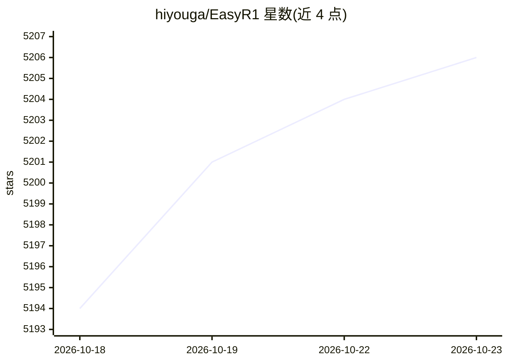

# hiyouga/EasyR1

⭐ 5,206 · Python · Apache-2.0 · 推送 2026-09-19 · [GitHub](https://github.com/hiyouga/EasyR1) · [官网](https://verl.readthedocs.io) · 个人维护 · 中文 README

**基于 veRL 的多模态大模型 RL 训练框架，面向开发者**

EasyR1 是 veRL 项目的 fork，面向需要强化学习训练视觉语言模型与语言模型的开发者。它基于 HybridEngine 与 vLLM 的 SPMD 模式实现训练，支持 Llama3/Qwen 系列语言模型与 Qwen2-VL 系列视觉语言模型，内置 GRPO、DAPO、Reinforce++、RLOO 等算法，并提供 padding-free 训练、LoRA 微调、断点续训与多节点 Ray 训练。硬件要求较高，7B 全量微调需 8*40GB 显存。提供 Docker 镜像与源码 pip 安装两种方式。

## 筛选速览

| 维度 | 判定 | 备注 |
|---|---|---|
| AI 角色 | `ai-ecosystem` | LLM/agent 周边工具 |
| 许可风险 | `permissive` | Apache-2.0 |
| 部署形态 | `self-host` | docker 或自建部署 |
| 模型依赖 | local-ok | 支持本地模型 |
| 硬件要求 | — | 无带数字的原话,不猜 |
| 安装摩擦 | `low` | 无编译、无系统依赖或容器化 |
| 成熟度 | — | 结构信号不足 |

## 能力要点

- 支持 GRPO/DAPO/Reinforce++/RLOO/GSPO 等多种 RL 算法
- 支持 Qwen2/2.5/3-VL 等视觉语言模型与 DeepSeek-R1 蒸馏模型
- LoRA 微调与 padding-free 训练、断点续训
- 基于 Ray 的多节点训练与 vLLM SPMD 推理

## 适用场景

- 对多模态大模型做 GRPO 强化学习训练
- 用 LoRA 在有限显存下微调 Qwen 系列模型
- 多节点扩展训练 70B 以上模型

## 场景标签

`强化学习` `微调` · 领域:训练与推理

## 证据(README 行号)

> L1: # EasyR1: An Efficient, Scalable, Multi-Modality RL Training Framework
> L15: This project is a clean fork of the original veRL project to support vision language models, we thank all the autho
> L27:  - GRPO

## 星数曲线

2026-10-18 5,194 → 2026-10-23 5,206（+12）

---
*卡片 v1 · prompt 1.4 · 生成 2026-10-20 · 置信度 high · 依据 README sha `1105df14e148` · [字段定义](../../DATASET.md)*
