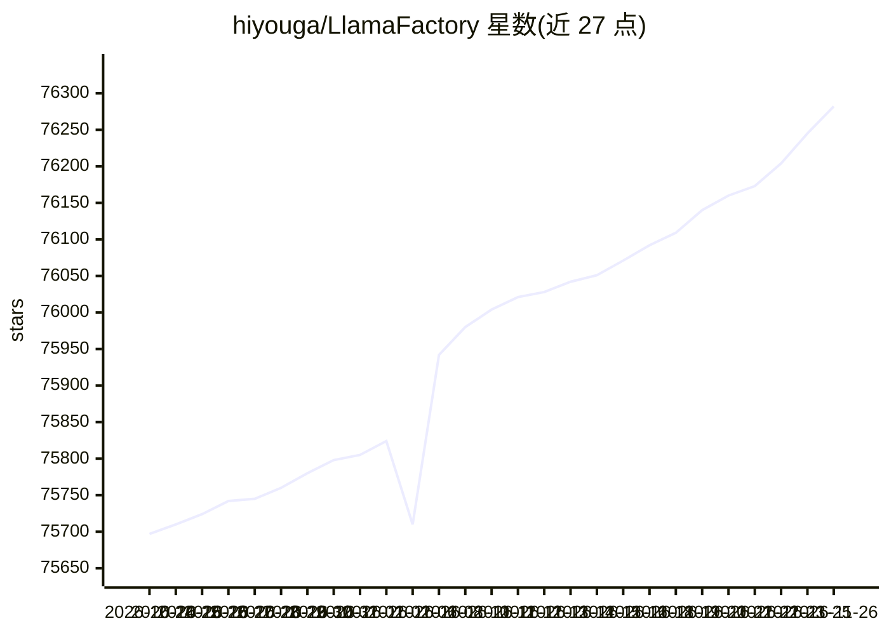

# hiyouga/LlamaFactory

⭐ 76,282 · Python · Apache-2.0 · 推送 2026-11-25 · [GitHub](https://github.com/hiyouga/LlamaFactory) · [官网](https://llamafactory.readthedocs.io) · 个人维护 · 中文 README

**微调 100+ 大模型与多模态模型的训练框架**

统一的 LLM/VLM 高效微调框架（ACL 2024 论文）：支持预训练、指令微调、奖励建模及 PPO/DPO/KTO/ORPO 等对齐训练，覆盖 LoRA/QLoRA 等参数高效方法与 16-bit 全量微调。以零代码 CLI 与 Web UI 两种方式启动训练，内置百余个数据集与数十种模型的对话模板，支持多轮对话、工具调用、图像/视频/音频理解等任务。训练后可通过 vLLM/SGLang worker 提供 OpenAI 风格 API、Gradio UI 和 CLI 推理。要求 Python 3.11+、torch 2.0+；CUDA、deepspeed 等为可选依赖。

## 筛选速览

| 维度 | 判定 | 备注 |
|---|---|---|
| AI 角色 | `ai-ecosystem` | LLM/agent 周边工具 |
| 许可风险 | `permissive` | Apache-2.0 |
| 部署形态 | `self-host` | docker 或自建部署 |
| 模型依赖 | local-ok | 支持本地模型 |
| 硬件要求 | — | 无带数字的原话,不猜 |
| 安装摩擦 | `low` | 无编译、无系统依赖或容器化 |
| 成熟度 | — | 结构信号不足 |

## 动量与使用信号

- 维护:`active` — 距上次 push 8.0 天,年发版 2,283 位贡献者
- 涨星:近 1 天 **+32**(自 20261016 起算)
- 安装:pypi 包 `requirements` 月下载无数据
- 平台:WINDOWS / MACOS / LINUX / WEB · 协议:OLLAMA

## 能力要点

- 支持 100+ LLM 与 VLM 的微调，含 Day-0 跟进新模型
- 覆盖 PPO/DPO/KTO/ORPO/SimPO 等对齐训练与 LoRA/QLoRA 高效方法
- 零代码 CLI 与 Web UI 启动训练，内置大量中英文数据集
- 推理阶段提供 OpenAI 风格 API、Gradio UI 与 vLLM/SGLang worker

## 适用场景

- 对开源大模型做 LoRA/QLoRA 指令微调
- 对多模态模型（视觉/音频）做监督微调
- 用 DPO/PPO 等方法做偏好对齐与强化学习训练
- 微调后通过 vLLM 部署 OpenAI 风格 API

## 场景标签

`微调` `强化学习` · 领域:训练与推理

## 证据(README 行号)

> L36: ### Easily fine-tune 100+ large language models with zero-code CLI and Web UI
> L69: - **Various models**: LLaMA, LLaVA, Mistral, Mixtral-MoE, Qwen3, Qwen3-VL, DeepSeek, Gemma, GLM, Phi, etc.
> L76: - **Faster inference**: OpenAI-style API, Gradio UI and CLI with vLLM worker or SGLang worker.

## 星数曲线

2026-10-24 75,697 → 2026-11-26 76,282（+585）

---
*卡片 v1 · prompt 1.4 · 生成 2026-11-26 · 置信度 high · 依据 README sha `368fb91c52a4` · [字段定义](../../DATASET.md)*
