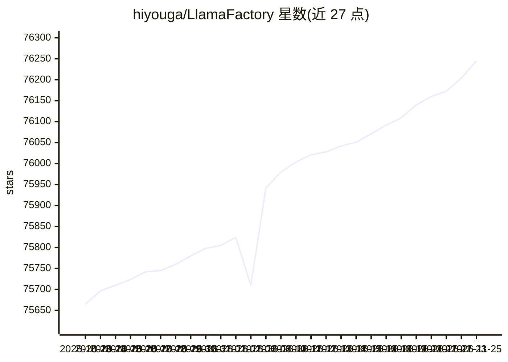

# hiyouga/LlamaFactory

⭐ 76,245 · Python · Apache-2.0 · 推送 2026-11-23 · [GitHub](https://github.com/hiyouga/LlamaFactory) · [官网](https://llamafactory.readthedocs.io) · 个人维护 · 中文 README

**为开发者提供 100+ LLM/VLM 的统一微调训练框架**

以零代码 CLI 与 Web UI 的形式对 100 余个大语言与多模态模型做统一微调：覆盖 (多模态) 预训练、SFT、奖励建模及 PPO/DPO/KTO/ORPO 等对齐训练方法，支持 16-bit 全量、freeze、LoRA 与多比特 QLoRA（AQLM/AWQ/GPTQ 等）。内置 LlamaBoard/TensorBoard/Wandb 等实验监控，推理侧提供 OpenAI 风格 API、Gradio UI 与 CLI，可挂接 vLLM/SGLang worker。README 给出 Python/torch/transformers 等版本要求、各训练方法的显存估算表，并提供 Colab/PAI-DSW/AMD GPU Cloud 等云端训练入口与 Docker 镜像；论文发表于 ACL 2024。

## 筛选速览

| 维度 | 判定 | 备注 |
|---|---|---|
| AI 角色 | `ai-ecosystem` | LLM/agent 周边工具 |
| 许可风险 | `permissive` | Apache-2.0 |
| 部署形态 | `self-host` | docker 或自建部署 |
| 模型依赖 | local-ok | 支持本地模型 |
| 硬件要求 | — | 无带数字的原话,不猜 |
| 安装摩擦 | `low` | 无编译、无系统依赖或容器化 |
| 成熟度 | — | 结构信号不足 |

## 动量与使用信号

- 维护:`active` — 距上次 push 8.0 天,年发版 2,283 位贡献者
- 涨星:近 1 天 **+32**(自 20261016 起算)
- 安装:pypi 包 `requirements` 月下载无数据
- 平台:WINDOWS / MACOS / LINUX / WEB · 协议:OLLAMA

## 能力要点

- 100+ LLM/VLM 模型的统一微调支持（Day-0/Day-1 跟进新模型）
- (Continuous) 预训练、SFT、奖励建模、PPO/DPO/KTO/ORPO 等 8 类训练方法
- LoRA 与 2-8-bit QLoRA 量化微调（AQLM/AWQ/GPTQ/LLM.int8/HQQ/EETQ）
- OpenAI 风格 API、Gradio UI、CLI 推理，支持 vLLM/SGLang worker

## 适用场景

- 对开源大模型做指令微调或偏好对齐训练
- 在有限显存下用 QLoRA 微调 7B-70B 模型
- 多模态模型（图像/视频/音频理解）的监督微调
- 训练后经 OpenAI 风格 API 或 vLLM 部署推理

## 场景标签

`微调` `模型训练` `强化学习` · 领域:训练与推理

## 证据(README 行号)

> L36: ### Easily fine-tune 100+ large language models with zero-code CLI and Web UI
> L70: - **Integrated methods**: (Continuous) pre-training, (multimodal) supervised fine-tuning, reward modeling, PPO, DPO
> L76: - **Faster inference**: OpenAI-style API, Gradio UI and CLI with vLLM worker or SGLang worker.

## 星数曲线

2026-10-23 75,665 → 2026-11-25 76,245（+580）

---
*卡片 v1 · prompt 1.4 · 生成 2026-11-24 · 置信度 high · 依据 README sha `4b28bc58dbef` · [字段定义](../../DATASET.md)*
