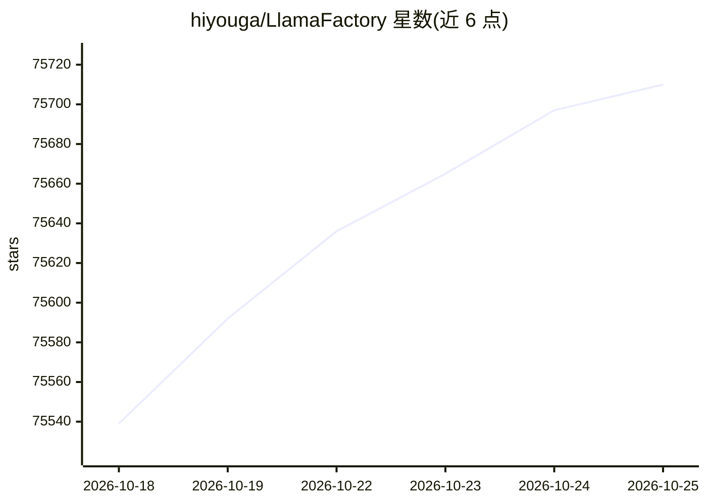

# hiyouga/LlamaFactory

⭐ 75,724 · Python · Apache-2.0 · 推送 2026-10-21 · [GitHub](https://github.com/hiyouga/LlamaFactory) · [官网](https://llamafactory.readthedocs.io) · 组织维护 · 中文 README

**面向开发者的 100+ LLM/VLM 统一微调工具**

以 CLI 与零代码 Web UI 提供 100+ 大语言模型与视觉语言模型的微调能力，覆盖预训练、SFT、奖励建模及 PPO/DPO/KTO/ORPO 等训练方法，支持 LoRA 与多比特 QLoRA 量化微调。内置数十个模型对话模板，提供 Hugging Face 数据集清单、TensorBoard/Wandb 等实验监控，并可经 vLLM/SGLang worker 以 OpenAI 风格 API、Gradio UI 或 CLI 推理。README 给出按训练方法与模型规模估算的显存需求表，支持本地训练与 Colab/PAI-DSW/AMD GPU Cloud 云端训练。

## 筛选速览

| 维度 | 判定 | 备注 |
|---|---|---|
| AI 角色 | `ai-ecosystem` | LLM/agent 周边工具 |
| 许可风险 | `permissive` | Apache-2.0 |
| 部署形态 | `self-host` | docker 或自建部署 |
| 模型依赖 | local-ok | 支持本地模型 |
| 硬件要求 | — | 无带数字的原话,不猜 |
| 安装摩擦 | `low` | 无编译、无系统依赖或容器化 |
| 成熟度 | `idea` | |

## 动量与使用信号

- 维护:`active` — 距上次 push 8.0 天,年发版 2,283 位贡献者
- 涨星:近 1 天 **+32**(自 20261016 起算)
- 安装:pypi 包 `requirements` 月下载无数据
- 平台:WINDOWS / MACOS / LINUX / WEB · 协议:OLLAMA

## 能力要点

- 支持 100+ LLM/VLM 与 8 种训练方法（Pre-Training/SFT/Reward/PPO/DPO/KTO/ORPO/SimPO）
- LoRA 与 2/3/4/5/6/8-bit QLoRA 量化微调
- 零代码 CLI 与 Web UI，附带 OpenAI 风格 API 与 vLLM/SGLang 推理 worker
- 内置大量中英文训练数据集清单与模型模板管理

## 适用场景

- 微调开源大模型适配领域任务
- 用 LoRA/QLoRA 在有限显存下训练模型
- 微调后通过 API 部署推理服务

## 场景标签

`微调` `模型训练` `强化学习` · 领域:训练与推理

## 证据(README 行号)

> L35: ### Easily fine-tune 100+ large language models with zero-code CLI and Web UI
> L68: - **Various models**: LLaMA, LLaVA, Mistral, Mixtral-MoE, Qwen3, Qwen3-VL, DeepSeek, Gemma, GLM, Phi, etc.
> L69: - **Integrated methods**: (Continuous) pre-training, (multimodal) supervised fine-tuning, reward modeling, PPO, DPO

## 星数曲线

2026-10-18 75,539 → 2026-10-25 75,710（+171）

---
*卡片 v1 · prompt 1.4 · 生成 2026-10-18 · 置信度 high · 依据 README sha `9314dfb37019` · [字段定义](../../DATASET.md)*
