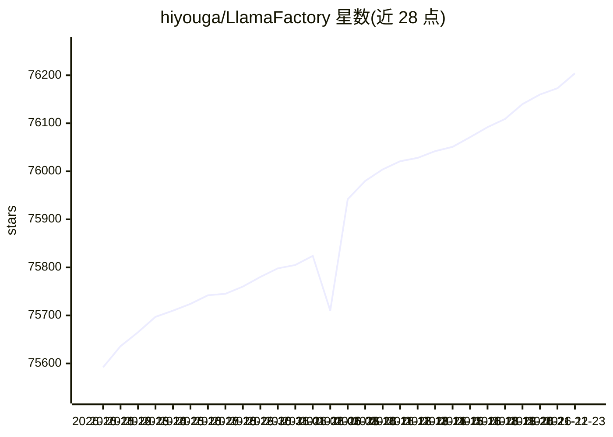

# hiyouga/LlamaFactory

⭐ 76,204 · Python · Apache-2.0 · 推送 2026-11-21 · [GitHub](https://github.com/hiyouga/LlamaFactory) · [官网](https://llamafactory.readthedocs.io) · 组织维护 · 中文 README

**零代码微调 100+ 大语言与多模态模型的统一框架**

统一的 LLM/VLM 高效微调框架：支持 (多模态) 预训练、SFT、奖励建模及 PPO/DPO/KTO/ORPO 等训练方法，量化位宽覆盖 16-bit 全参到 2/8-bit QLoRA，集成 GaLore、DoRA、LongLoRA 等算法与 FlashAttention-2、Unsloth 等加速技巧。以 zero-code CLI 和 Web UI 形式提供微调入口，训练后可通过 vLLM/SGLang worker 提供 OpenAI 风格 API、Gradio UI 与 CLI 推理；用户主要为模型开发者与研究者。ACL 2024 论文发布。

## 筛选速览

| 维度 | 判定 | 备注 |
|---|---|---|
| AI 角色 | `ai-ecosystem` | LLM/agent 周边工具 |
| 许可风险 | `permissive` | Apache-2.0 |
| 部署形态 | `self-host` | docker 或自建部署 |
| 模型依赖 | local-ok | 支持本地模型 |
| 硬件要求 | — | 无带数字的原话,不猜 |
| 安装摩擦 | `low` | 无编译、无系统依赖或容器化 |
| 成熟度 | — | 结构信号不足 |

## 动量与使用信号

- 维护:`active` — 距上次 push 8.0 天,年发版 2,283 位贡献者
- 涨星:近 1 天 **+32**(自 20261016 起算)
- 安装:pypi 包 `requirements` 月下载无数据
- 平台:WINDOWS / MACOS / LINUX / WEB · 协议:OLLAMA

## 能力要点

- 支持 100+ LLM/VLM 模型的统一微调（Day-0/Day-1 跟进前沿模型）
- 覆盖预训练、SFT、奖励建模、PPO/DPO/KTO/ORPO 等训练方法
- LoRA/QLoRA 至 2/3/4/5/6/8-bit，集成 GaLore、BAdam、DoRA、LongLoRA 等算法
- 提供 zero-code CLI 与 Web UI，推理支持 vLLM/SGLang worker 的 OpenAI 风格 API

## 适用场景

- 用 LoRA/QLoRA 在单卡上微调开源大模型
- 多模态模型（图像/视频/音频理解）的监督微调
- PPO/DPO 等偏好对齐训练与奖励建模
- 通过 Web UI 零代码完成微调流程

## 场景标签

`微调` `强化学习` `模型量化` `模型训练` · 领域:训练与推理

## 证据(README 行号)

> L36: ### Easily fine-tune 100+ large language models with zero-code CLI and Web UI
> L69: - **Various models**: LLaMA, LLaVA, Mistral, Mixtral-MoE, Qwen3, Qwen3-VL, DeepSeek, Gemma, GLM, Phi, etc.
> L70: - **Integrated methods**: (Continuous) pre-training, (multimodal) supervised fine-tuning, reward modeling, PPO, DPO

## 星数曲线

2026-10-21 75,592 → 2026-11-23 76,204（+612）

---
*卡片 v1 · prompt 1.4 · 生成 2026-11-22 · 置信度 high · 依据 README sha `29dc1998ac59` · [字段定义](../../DATASET.md)*
