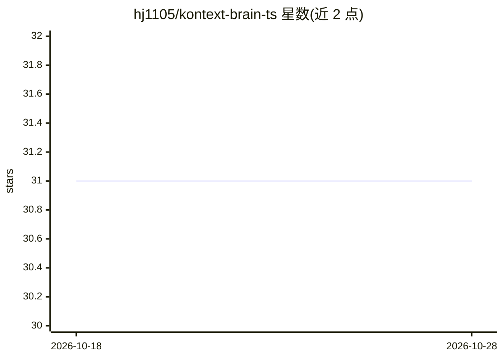

# hj1105/kontext-brain-ts

⭐ 31 · TypeScript · Apache-2.0 · 推送 2026-10-19 · [GitHub](https://github.com/hj1105/kontext-brain-ts) · [官网](https://hj1105.github.io/kontext-brain-ts/) · 个人维护 · 中文 README

**TypeScript 知识图谱 RAG 框架：为 AI agent 提供可溯源检索**

Apache-2.0 的 TypeScript/Node.js RAG 框架，面向 AI agent 与 MCP 客户端。它将多源知识组织为 Resource、Chunk、Entity、Fact 与 ACL 感知的 Evidence 结构，通过 Lift→Expand→Ground 有界遍历与图/向量/BM25 融合、覆盖感知重排序进行混合检索，仅水合被选为证据的 Chunk 用于回答。以 8 个 npm 包构成的 monorepo 提供，包括 LangChain.js 适配、MCP server（暴露 6 个工具给 Claude Desktop/Cursor 等）、PostgreSQL/pgvector 存储（含 RLS 权限）与 S3 对象存储。自带 RAG 评测 harness，默认 v13 锚定证据栈；README 声明基准范围较窄、部分对比使用预计算 KG，属回归证据而非独立可复现基准。

## 筛选速览

| 维度 | 判定 | 备注 |
|---|---|---|
| AI 角色 | `ai-ecosystem` | LLM/agent 周边工具 |
| 许可风险 | `permissive` | Apache-2.0 |
| 部署形态 | `library` | 以包/库形式分发 |
| 模型依赖 | local-ok | 支持本地模型 |
| 硬件要求 | — | 无带数字的原话,不猜 |
| 安装摩擦 | `low` | 无编译、无系统依赖或容器化 |
| 成熟度 | `idea` | |

## 能力要点

- Resource/Chunk/Entity/Fact/Evidence 的 N 层知识图谱结构与 ACL 权限感知证据
- 图/向量/BM25 融合 + 覆盖感知重排序 + 证据约束回答的 v13 默认栈
- 8 个发布包：MCP server（6 个工具）、LangChain.js 适配器、PostgreSQL/pgvector 存储、S3 对象存储等
- 接入 Notion/Jira/GitHub PR/Slack 的 MCP 连接器与官方 SDK 的 stdio/SSE 客户端

## 适用场景

- 为 AI agent 或 MCP 客户端提供带来源追溯的知识检索工具
- 把 Notion/Slack/GitHub 等外部系统结构化为可查询的知识图谱
- 需要行级权限（RLS）控制的 PostgreSQL 知识层部署
- 运行带评测 harness 的知识图谱 RAG 实验

## 场景标签

`RAG` `知识图谱` · 领域:知识与检索

## 证据(README 行号)

> L9: kontext-brain-ts is an Apache-2.0 TypeScript / Node.js RAG framework for AI agents.
> L18: A retrieval framework that structures multi-source knowledge as Resources,
> L174: |`@kontext-brain/tool-server`|MCP server exposing kontext as 6 tools to any MCP client (Claude Desktop, Claude Cod

## 星数曲线

2026-10-18 31 → 2026-10-28 31（+0）

---
*卡片 v1 · prompt 1.4 · 生成 2026-10-26 · 置信度 high · 依据 README sha `c53447cc534e` · [字段定义](../../DATASET.md)*
