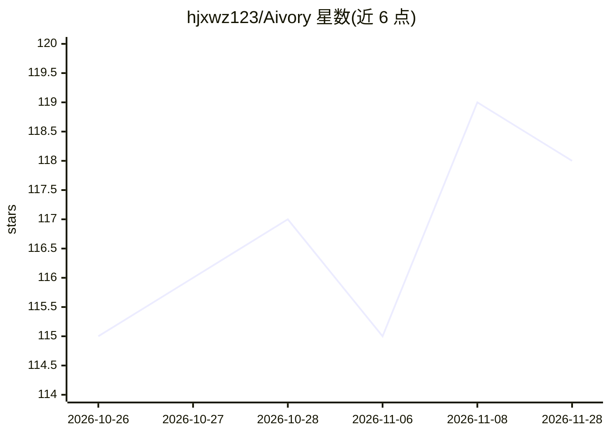

# hjxwz123/Aivory

⭐ 118 · Go · NOASSERTION · 推送 2026-11-24 · [GitHub](https://github.com/hjxwz123/Aivory) · [官网](https://docs.aivorygo.com) · 个人维护

**自托管 AI 工作区：个人与团队的对话/研究/知识平台**

自托管的 AI 工作空间，将对话、研究、创作与共享知识整合到一处：可为不同任务选用不同模型，网页与文档检索、持续追问的 Deep Research 流程，将结果生成代码/图片/报告/表格/演示文稿；支持从团队文档建库并引用来源；提供个人与团队工作区隔离，以及模型服务配置、成员权限、用量与费用审查、备份恢复等管理功能。部署依赖 Docker 24+ 与 Docker Compose，全量档用 PostgreSQL/Redis，个人档用 SQLite。

## 筛选速览

| 维度 | 判定 | 备注 |
|---|---|---|
| AI 角色 | `ai-native` | 本体是模型或模型工具 |
| 许可风险 | `none` | NOASSERTION |
| 部署形态 | `self-host` | docker 或自建部署 |
| 模型依赖 | — | README 未给出锁定关系 |
| 硬件要求 | — | 无带数字的原话,不猜 |
| 安装摩擦 | `low` | 无编译、无系统依赖或容器化 |
| 成熟度 | — | 结构信号不足 |

## 能力要点

- 多步工具调用与持久化 Python 沙箱
- RAG 知识库：从团队文档建库并在对话中引用来源
- 个人与团队工作区隔离及成员/用量/费用管理
- 支持 Claude、GPT、Gemini 及任何 OpenAI 兼容服务

## 适用场景

- 团队自托管部署统一的 AI 工作入口，数据留在自己服务器
- 从检索、读网页/文档到产出报告/表格/演示文稿的完整研究流程
- 将团队常用文档建为知识库供反复复用

## 场景标签

`聊天机器人` `RAG` `文档问答` · 领域:对话与助手

## 证据(README 行号)

> L7: Aivory is a self-hosted AI workspace for individuals and teams. It brings conversations, research, creation, and sha
> L13: Aivory gives people one place to work with the AI services they choose. Conversations, files, research, and team pr
> L36: Deploy with Docker 24 or later and the Docker Compose plugin. Choose the personal profile for an individual server 

## 星数曲线

2026-10-26 115 → 2026-11-28 118（+3）

---
*卡片 v1 · prompt 1.4 · 生成 2026-11-28 · 置信度 high · 依据 README sha `a0ce9d14cd78` · [字段定义](../../DATASET.md)*
