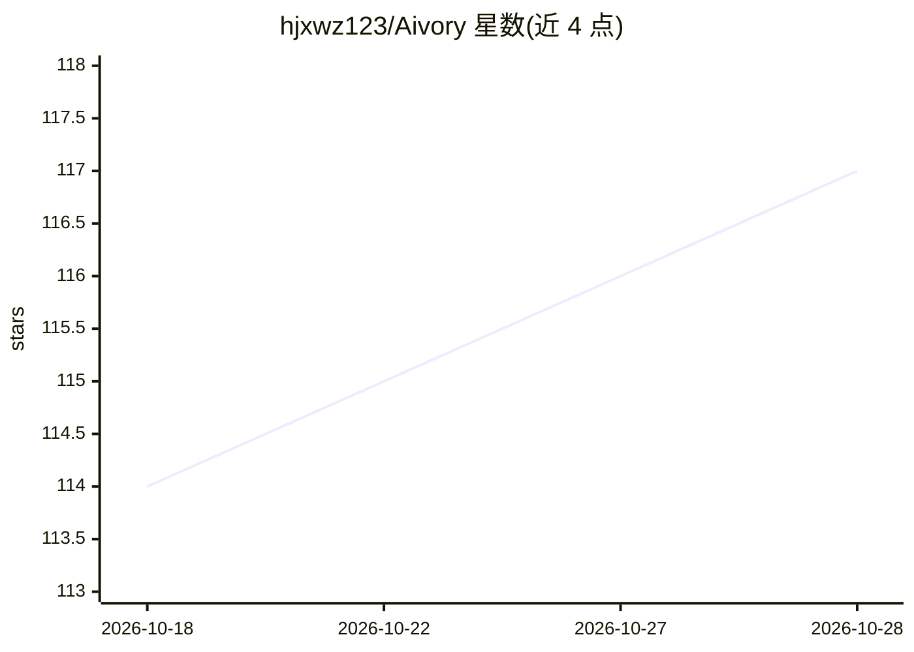

# hjxwz123/Aivory

⭐ 117 · Go · NOASSERTION · 推送 2026-10-28 · [GitHub](https://github.com/hjxwz123/Aivory) · [官网](https://docs.aivorygo.com) · 个人维护 · 中文 README

**自托管多模型 AI 对话工作台：工具链调用、Python 沙箱与 RAG**

自部署的 AI 聊天与工作区平台，面向个人和团队：单一界面接入 Claude、GPT、Gemini 及 OpenAI 兼容端点；编排器在单轮内最多执行 48 次工具调用（跨 12 个模型循环），工具可自由串联（搜索、网页抓取、Python、文件生成）。每会话配备隔离的持久 Python 沙箱（预装 pandas/matplotlib 等，网络禁用），支持知识库 RAG 检索与来源引用、团队工作区、订阅与配额管理。提供 Personal（App+SQLite）与 Full（PostgreSQL+Redis+Qdrant+sandbox）两档 Docker Compose 部署，另有 Electron 桌面壳连接已部署站点。

## 筛选速览

| 维度 | 判定 | 备注 |
|---|---|---|
| AI 角色 | `ai-native` | 本体是模型或模型工具 |
| 许可风险 | `permissive` | NOASSERTION |
| 部署形态 | `self-host` | docker 或自建部署 |
| 模型依赖 | locked-api |  |
| 硬件要求 | — | 无带数字的原话,不猜 |
| 安装摩擦 | `low` | 无编译、无系统依赖或容器化 |
| 成熟度 | — | 结构信号不足 |

## 能力要点

- 单轮最多 48 次工具调用、跨 12 个模型循环的工具编排
- 每会话隔离的持久 Python 沙箱，文件跨调用保留、沙箱网络禁用
- RAG 知识库检索与来源引用，向量检索默认保留在 Personal 档
- Personal 与 Full 两档 Docker Compose 部署，amd64/arm64 双平台镜像

## 适用场景

- 团队或个人自托管多模型 AI 对话与知识库工作台
- 一句话触发搜索-抓取-数据处理-PPT 生成的多步工具流水线
- 在隔离沙箱中对上传文档做数据分析与产物生成

## 场景标签

`AI 助手` `RAG` `数据分析` · 领域:效率与自动化

## 证据(README 行号)

> L22: |**Multi-model chat**|Use Claude, GPT, Gemini, image models, and OpenAI-compatible endpoints in one interface.|
> L23: |**Tools that work together**|Chain search, web fetching, Python, and file generation — up to **48 tool calls acros
> L25: |**Persistent sandbox**|Analyze data and create charts, spreadsheets, and presentations in an isolated workspace fo

## 星数曲线

2026-10-18 114 → 2026-10-28 117（+3）

---
*卡片 v1 · prompt 1.4 · 生成 2026-10-23 · 置信度 high · 依据 README sha `9281becbe044` · [字段定义](../../DATASET.md)*
