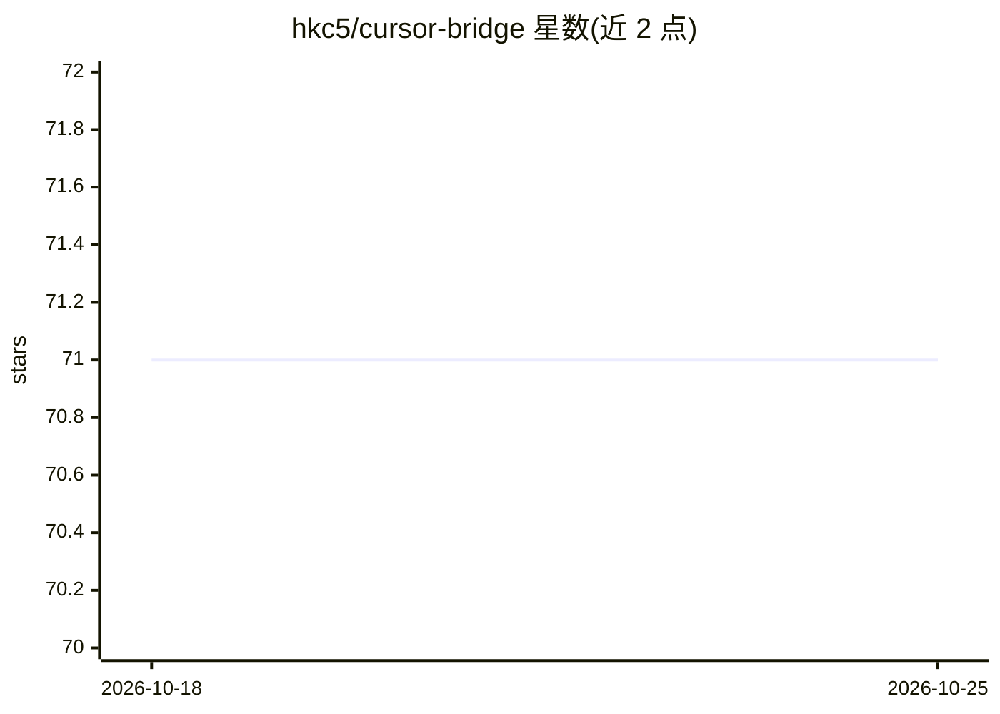

# hkc5/cursor-bridge

⭐ 71 · Rust · MIT · 推送 2026-10-10 · [GitHub](https://github.com/hkc5/cursor-bridge) · 个人维护

**用 Cursor 订阅后端运行 Claude Code 的 Rust 单二进制代理**

面向已订阅 Cursor 的开发者：通过启动本地 HTTP 代理，将 Claude Code 发出的 Anthropic API 调用翻译到 Cursor 的 agent CLI 后端，从而使用订阅内免费不限量的 Auto 模型，免去单独购买 Anthropic API 额度。实现为单个约 780 KB 静态编译的 Rust 二进制：自动从 macOS 钥匙串（Linux 需设 CURSOR_TOKEN 环境变量）读取 Cursor 认证令牌、随机端口、随会话结束自动清理。限制：无工作区沙箱、单账户、Linux 无钥匙串回退。

## 筛选速览

| 维度 | 判定 | 备注 |
|---|---|---|
| AI 角色 | `ai-ecosystem` | LLM/agent 周边工具 |
| 许可风险 | `permissive` | MIT |
| 部署形态 | `library` | 以包/库形式分发 |
| 模型依赖 | — | README 未给出锁定关系 |
| 硬件要求 | — | 无带数字的原话,不猜 |
| 安装摩擦 | `low` | 无编译、无系统依赖或容器化 |
| 成熟度 | — | 结构信号不足 |

## 能力要点

- 本地代理将 Anthropic API 调用翻译为 Cursor agent CLI 调用
- 单个约 780 KB 静态编译 Rust 二进制，随机端口、自动清理
- 支持交互式、一次性提示与管道三种运行模式
- macOS 自动读取钥匙串令牌

## 适用场景

- 已有 Cursor 订阅、想免费用 Claude Code CLI 的开发者
- 需要 Claude Code 的文件编辑/命令执行等 agent 能力但不接 Anthropic 计费
- 不想维护后台代理服务、偏好单命令即用的场景

## 场景标签

`模型网关` · 领域:Agent 开发

## 证据(README 行号)

> L19: With cursor-bridge, you just run `cursor-bridge` and it works — Claude Code runs on your Cursor backend.
> L41:   ├── Proxy translates Anthropic API calls → Cursor agent CLI

## 星数曲线

2026-10-18 71 → 2026-10-25 71（+0）

---
*卡片 v1 · prompt 1.4 · 生成 2026-10-24 · 置信度 mid · 依据 README sha `69bcff61ed0c` · [字段定义](../../DATASET.md)*
