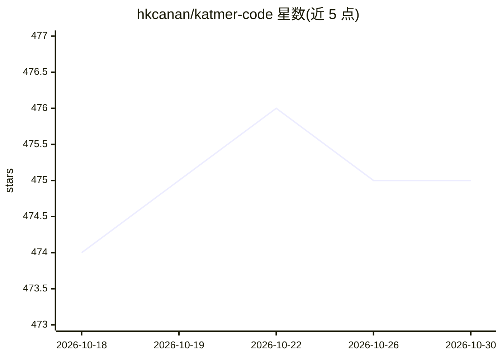

# hkcanan/katmer-code

⭐ 475 · TypeScript · MIT · 推送 2026-09-15 · [GitHub](https://github.com/hkcanan/katmer-code) · 个人维护

**Obsidian 多供应商 AI 侧边栏插件：四家 AI 助手同栏对话与学术研究技能**

Obsidian 桌面端插件，在侧边栏接入 Claude Code、Gemini、Codex、Antigravity 四个 AI 供应商（各经对应 CLI 登录），每个对话标签页可固定不同供应商与模型，支持同标签页咨询第二模型并合成、行内 diff 编辑、CLAUDE.md 自动镜像到 GEMINI.md/AGENTS.md、MCP 配置读取。内置 7 个学术研究斜杠命令（同行评审、引文核验、文献检索、期刊匹配等），查询 Semantic Scholar/CrossRef/OpenAlex/arXiv/PubMed 等数据库并生成 HTML 报告。需从源码构建安装，桌面端专用。

## 筛选速览

| 维度 | 判定 | 备注 |
|---|---|---|
| AI 角色 | `ai-native` | 本体是模型或模型工具 |
| 许可风险 | `permissive` | MIT |
| 部署形态 | `library` | 以包/库形式分发 |
| 模型依赖 | locked-api |  |
| 硬件要求 | — | 无带数字的原话,不猜 |
| 安装摩擦 | `low` | 无编译、无系统依赖或容器化 |
| 成熟度 | — | 结构信号不足 |

## 能力要点

- 每个聊天标签页独立固定供应商与模型，同标签页可咨询另一模型并合成
- 行内词级 diff 编辑（接受/撤销），Claude 与 Gemini 支持
- 7 个学术研究技能：同行评审、引文核验、文献检索、期刊匹配等，输出 HTML 报告
- CLAUDE.md 自定义规则自动镜像到 GEMINI.md 与 AGENTS.md

## 适用场景

- 在 Obsidian 写作时对比多家模型对同一稿件的反馈
- 投稿前做同行评审模拟与引文逐条核验
- 用斜杠命令做文献检索、研究空白分析与期刊匹配

## 场景标签

`AI 助手` `科研工具` · 领域:对话与助手

## 证据(README 行号)

> L3: Multi-provider AI chat inside Obsidian — Claude, Gemini, Codex, and Antigravity in one sidebar, with per-tab routing
> L9: An Obsidian plugin that puts four AI assistants in your sidebar — each chat tab can run a different provider. Built 
> L73: ## Academic Skills

## 星数曲线

2026-10-18 474 → 2026-10-30 475（+1）

---
*卡片 v1 · prompt 1.4 · 生成 2026-10-21 · 置信度 high · 依据 README sha `94f97e936fea` · [字段定义](../../DATASET.md)*
