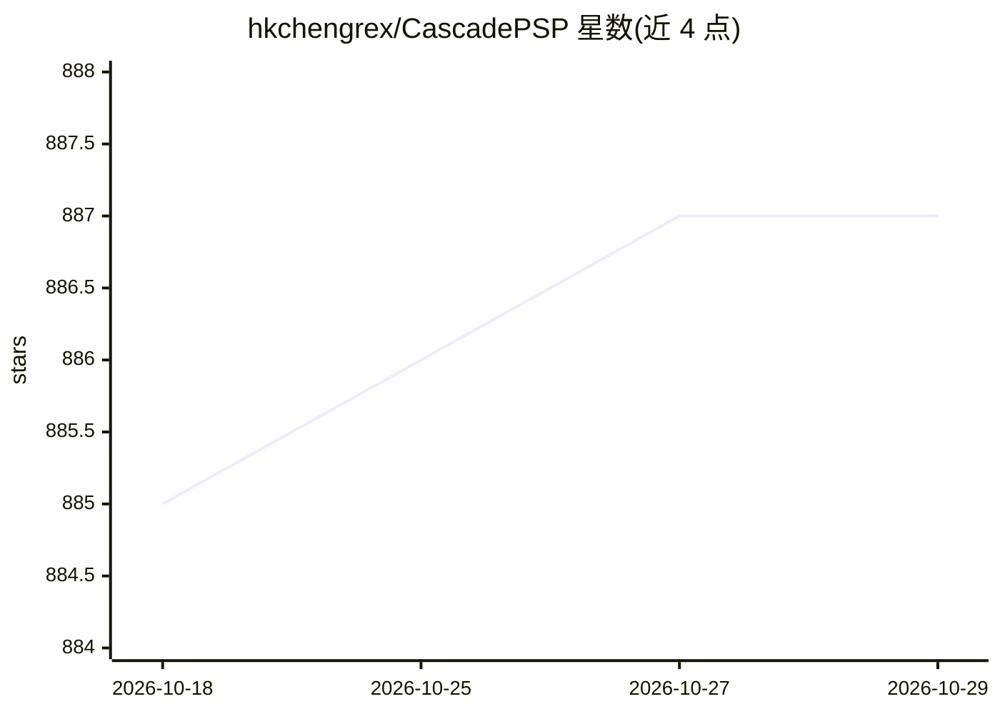

# hkchengrex/CascadePSP

⭐ 887 · Python · MIT · 推送 2026-01-02 · [GitHub](https://github.com/hkchengrex/CascadePSP) · [官网](https://hkchengrex.com/CascadePSP/) · 个人维护

**高分辨率分割掩码精修的 PyTorch 模型与训练代码**

CVPR 2020 论文的官方 PyTorch 实现：CascadePSP 是一个类别无关的高分辨率分割精修深度模型，通过全局步骤与局部步骤两阶段精修模块，对已有分割掩码做细化。仓库提供训练与测试代码、标注的 UHD 数据集 BIG 以及预训练模型，并封装为 pip 包 segmentation-refinement，两行代码即可对输入图像做精修。在 PyTorch 1.0 上测试，更高版本可能可用于推理。

## 筛选速览

| 维度 | 判定 | 备注 |
|---|---|---|
| AI 角色 | `ai-native` | 本体是模型或模型工具 |
| 许可风险 | `permissive` | MIT |
| 部署形态 | `library` | 以包/库形式分发 |
| 模型依赖 | — | README 未给出锁定关系 |
| 硬件要求 | — | 无带数字的原话,不猜 |
| 安装摩擦 | `low` | 无编译、无系统依赖或容器化 |
| 成熟度 | — | 结构信号不足 |

## 能力要点

- 类别无关的高分辨率分割掩码精修（全局步骤+局部步骤）
- 提供预训练模型与标注 UHD 数据集 BIG
- pip 包 segmentation-refinement，两行代码完成精修
- 包含训练与测试功能

## 适用场景

- 把粗分割模型输出的掩码细化到高分辨率
- 在自有数据上训练或复现分割精修实验
- 研究与引用 CVPR 2020 分割精修方法

## 场景标签

`图像视频处理` · 领域:感知与多模态

## 证据(README 行号)

> L15: CascadePSP is a deep learning model for high-resolution segmentation refinement.
> L16: This repository contains our PyTorch implementation with both training and testing functionalities. We also provide

## 星数曲线

2026-10-18 885 → 2026-10-29 887（+2）

---
*卡片 v1 · prompt 1.4 · 生成 2026-10-21 · 置信度 high · 依据 README sha `41c1f7f4790c` · [字段定义](../../DATASET.md)*
