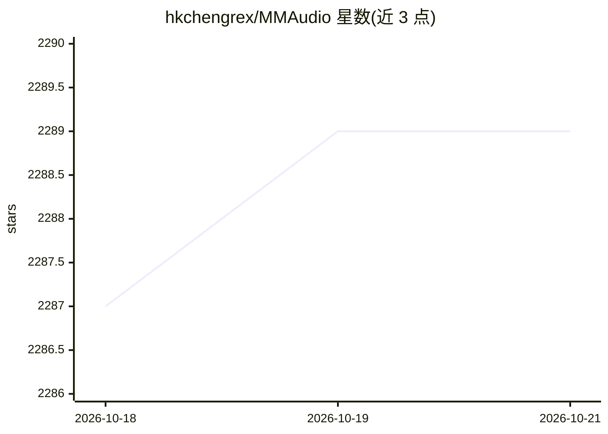

# hkchengrex/MMAudio

⭐ 2,289 · Python · MIT · 推送 2026-02-23 · [GitHub](https://github.com/hkchengrex/MMAudio) · [官网](https://hkchengrex.com/MMAudio/) · 组织维护

**给开发者的视频/文本生成同步音频的模型（CVPR 2025）**

MMAudio 是一个视频转音频与文本转音频合成模型（CVPR 2025），基于多模态联合训练，在多种视听与音文数据集上训练，并含同步模块将生成音频与视频帧对齐。提供命令行脚本与 Gradio 界面运行推理，权重自动从 HuggingFace 下载（默认 large_44k_v2），16 位推理约需 6GB 显存；也提供训练与评测脚本。仅在 Ubuntu 测试，输出时长默认 8 秒，已知限制包括偶发无意义人声与背景音乐质量不稳定。

## 筛选速览

| 维度 | 判定 | 备注 |
|---|---|---|
| AI 角色 | `ai-native` | 本体是模型或模型工具 |
| 许可风险 | `permissive` | MIT |
| 部署形态 | `library` | 以包/库形式分发 |
| 模型依赖 | — | README 未给出锁定关系 |
| 硬件要求 | — | 无带数字的原话,不猜 |
| 安装摩擦 | `high` | 编译与系统依赖俱全 |
| 成熟度 | — | 结构信号不足 |

## 能力要点

- 视频+文本输入生成与画面同步的音频
- 多模态联合训练与同步模块
- 提供 CLI、Gradio 界面及训练/评测脚本
- 权重自动下载，16 位推理约 6GB 显存

## 适用场景

- 为无声视频生成同步音效
- 通过文本提示合成音频
- 复现论文训练或进行音视频生成评测

## 场景标签

`多模态` · 领域:感知与多模态

## 证据(README 行号)

> L14: MMAudio generates synchronized audio given video and/or text inputs.
> L15: Our key innovation is multimodal joint training which allows training on a wide range of audio-visual and audio-tex

## 星数曲线

2026-10-18 2,287 → 2026-10-21 2,289（+2）

---
*卡片 v1 · prompt 1.4 · 生成 2026-10-21 · 置信度 high · 依据 README sha `55efd0eaa379` · [字段定义](../../DATASET.md)*
