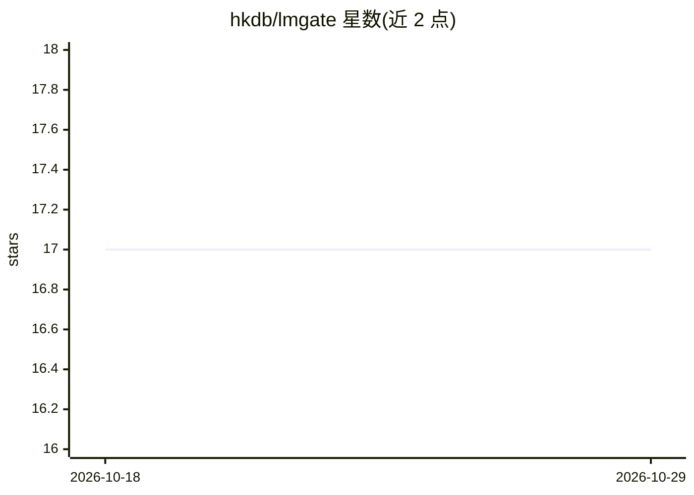

# hkdb/lmgate

⭐ 17 · Go · Apache-2.0 · 推送 2026-06-11 · [GitHub](https://github.com/hkdb/lmgate) · [官网](https://lmgate.3df.io) · 个人维护

**面向自托管 LLM 后端的认证与访问控制网关**

置于上游模型服务器（如 Ollama）之前的 API 网关，在不修改上游服务的前提下提供身份认证（API token + JWT、OAuth2/OIDC SSO）、多因素认证、按用户/通配符的模型 ACL、速率限制、审计日志与用量指标，内嵌 SvelteKit 管理面板。热路径上仅做认证/限流/ACL/代理，日志与指标在后台 goroutine 异步处理，数据存于单个 SQLite（WAL）数据库。以 Docker 镜像（含与 Ollama 打包的 Omnigate 变体）或单二进制形式部署。作者声明其仍为早期阶段、待第三方审计。

## 筛选速览

| 维度 | 判定 | 备注 |
|---|---|---|
| AI 角色 | `ai-ecosystem` | LLM/agent 周边工具 |
| 许可风险 | `permissive` | Apache-2.0 |
| 部署形态 | `None` |  |
| 模型依赖 | local-ok | 支持本地模型 |
| 硬件要求 | `cpu-ok` | |
| 安装摩擦 | `low` | 无编译、无系统依赖或容器化 |
| 成熟度 | `idea` | |

## 能力要点

- API token + JWT/OAuth2/OIDC 认证与 TOTP/WebAuthn 多因素认证
- 按用户与通配符模式的模型 ACL 及每用户/每 token 速率限制
- 审计与安全事件日志（fail2ban 就绪）及用量指标
- Ollama 集成：管理员可直接拉取/删除模型

## 适用场景

- 把自托管 Ollama 服务安全地暴露到公网前加认证与限流
- 为不同用户分配可访问的模型白名单
- 审计 LLM API 调用并统计 token 用量

## 场景标签

`模型网关` `网络安全` · 领域:Agent 开发

## 证据(README 行号)

> L6: A high performance authentication and access-control gateway for LLM API backends such as Ollama. LM Gate sits in fr
> L18: LM Gate is an attempt to change that — a single component to plug into your existing infrastructure to handle secur
> L73:   ───────►  Auth ─► RateLimit ─► ModelACL ─► Proxy ──────────────► LLM

## 星数曲线

2026-10-18 17 → 2026-10-29 17（+0）

---
*卡片 v1 · prompt 1.4 · 生成 2026-10-29 · 置信度 high · 依据 README sha `491a48940743` · [字段定义](../../DATASET.md)*
