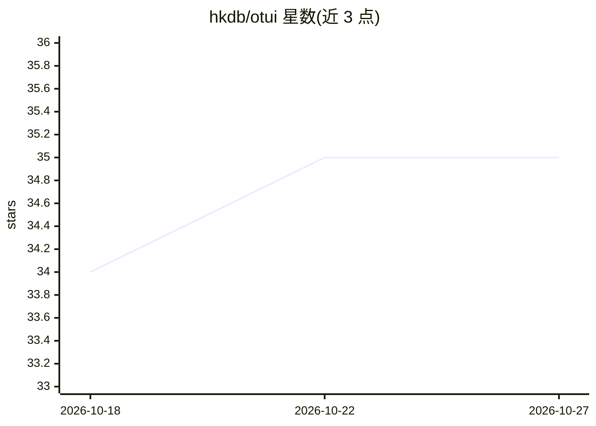

# hkdb/otui

⭐ 35 · Go · Apache-2.0 · 推送 2026-10-21 · [GitHub](https://github.com/hkdb/otui) · [官网](https://hkdb.github.io/otui) · 个人维护

**键盘驱动的终端 AI 聊天 TUI，内置 MCP 插件注册表**

面向键盘操作使用者的终端 AI 聊天界面（TUI）：与 LLM 对话获得流式回复与 Markdown 渲染，支持多会话管理、历史搜索、导入导出、系统提示词配置与多用户档案切换。可接入 Ollama、OpenRouter、Anthropic、OpenAI 及任意 OpenAI 兼容服务（llama.cpp、vLLM、LM Studio 等），其中 Ollama 与 OpenRouter 测试较多。内置 MCP 注册表与插件系统，支持引导式下载安装插件与工具调用审批。跨 Linux/macOS/FreeBSD/Windows 运行，提供脚本安装、Windows 二进制与 Docker 镜像。Windows 原生版本标注未测试。

## 筛选速览

| 维度 | 判定 | 备注 |
|---|---|---|
| AI 角色 | `ai-native` | 本体是模型或模型工具 |
| 许可风险 | `permissive` | Apache-2.0 |
| 部署形态 | `self-host` | docker 或自建部署 |
| 模型依赖 | local-ok | 支持本地模型 |
| 硬件要求 | — | 无带数字的原话,不猜 |
| 安装摩擦 | `low` | 无编译、无系统依赖或容器化 |
| 成熟度 | — | 结构信号不足 |

## 能力要点

- 接入 Ollama/OpenRouter/Anthropic/OpenAI 及 OpenAI 兼容服务，可切换多模型
- MCP 插件注册表与插件管理，支持工具调用前审批
- 会话历史、搜索、导入导出与单数据目录档案架构，便于同步迁移
- API 密钥可用 ssh 密钥对加密存储

## 适用场景

- 在终端中通过键盘完成 LLM 对话与多会话管理
- 为 AI 对话挂载 MCP 插件工具
- 把聊天档案同步到多台设备继续使用

## 场景标签

`聊天机器人` · 领域:对话与助手

## 证据(README 行号)

> L6: An opinionated, "speed" and "usability" focused agentic TUI with a built-in MCP registry/plugin system.
> L33: - Ollama

## 星数曲线

2026-10-18 34 → 2026-10-27 35（+1）

---
*卡片 v1 · prompt 1.4 · 生成 2026-10-25 · 置信度 high · 依据 README sha `fd860351b769` · [字段定义](../../DATASET.md)*
