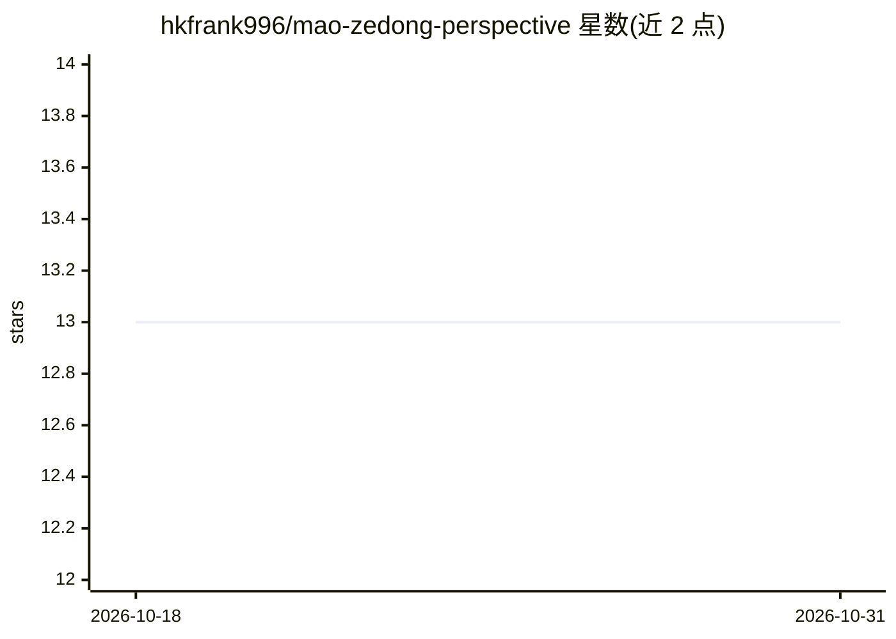

# hkfrank996/mao-zedong-perspective

⭐ 13 · MIT · 推送 2026-04-14 · [GitHub](https://github.com/hkfrank996/mao-zedong-perspective) · 个人维护 · 中文 README

**供 Agent 调用的毛泽东战略视角分析 skill**

以 SKILL.md + 技能目录形式交付的可移植 agent skill：将毛泽东公开著作、讲话与决策中反复出现的思维结构提炼为分析框架，包含 6 个心智模型、8 条决策启发式、表达风格与诚实边界，用于处理组织、战略、动员与矛盾分析问题。研究基于六维调研（著作、访谈、表达、外部评价、决策记录、时间线），研究文件随仓库公开。支持 Codex、Claude Code、OpenCode、OpenClaw 直接安装，Hermes 手动安装，方式为复制整个 skill 目录或运行 GitHub 安装脚本。不处理实时事实、史学定论与纯技术问题。

## 筛选速览

| 维度 | 判定 | 备注 |
|---|---|---|
| AI 角色 | `ai-knowledge` | 知识聚合/清单类 |
| 许可风险 | `permissive` | MIT |
| 部署形态 | `None` |  |
| 模型依赖 | — | README 未给出锁定关系 |
| 硬件要求 | — | 无带数字的原话,不猜 |
| 安装摩擦 | `low` | 无编译、无系统依赖或容器化 |
| 成熟度 | — | 结构信号不足 |

## 能力要点

- 6 个核心心智模型（敌友图谱、主要矛盾、持久战等）与 8 条决策启发式
- 六维调研文件随仓库公开，含一手文献索引
- SKILL.md + 技能目录的可移植包装，支持 5 种 agent 系统
- 明确声明适用与不适用边界，含历史后果的边界说明

## 适用场景

- 在 Codex/Claude Code 等 agent 中用该视角分析组织冲突与优先级
- 多方博弈、联盟与资源有限时的阶段规划参考
- 长期复杂任务的速决/持久判断与试点扩散策略分析

## 场景标签

`提示工程` · 领域:Agent 开发

## 证据(README 行号)

> L5: 一个可移植的历史人物视角 skill，用于分析战略、矛盾、组织与动员。
> L84: 这个仓库不是只写了一个 `SKILL.md`，而是把“怎么想、怎么判断、怎么说、什么不做、哪里有边界”一起打包了。
> L173: 它采用的是 `SKILL.md + 技能目录` 这种可移植包装，因此可以用于多种支持 skill / agent instructions / AgentSkills 风格目录的 agent 系统。

## 星数曲线

2026-10-18 13 → 2026-10-31 13（+0）

---
*卡片 v1 · prompt 1.4 · 生成 2026-10-31 · 置信度 high · 依据 README sha `e07c302639fd` · [字段定义](../../DATASET.md)*
