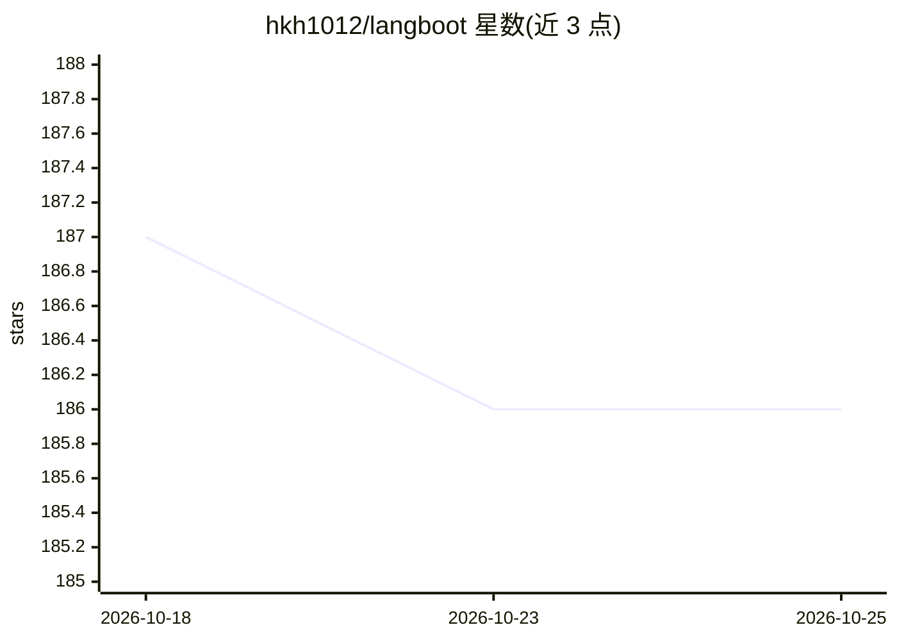

# hkh1012/langboot

⭐ 186 · Java · Apache-2.0 · 推送 2025-12-22 · [GitHub](https://github.com/hkh1012/langboot) · 个人维护 · 中文 README

**基于 SpringBoot 的 LangChain 式 AI 应用框架与知识库系统**

以 LangChain 思想在 Java 17+/SpringBoot 3.1.0 上构建 AI 应用的项目，提供统一接口接入 OpenAI、文心一言、智谱 GLM-4、Kimi、ChatGLM2 等大语言模型，支持流式聊天（SSE）、语音输入输出、本地知识库（上传 md/pdf/docx 等文档）、RAG 检索问答与向量库（weaviate/milvus/pgvector），并内置摘要、翻译、分类、文生图等 prompts 功能与前端界面。不涉及模型微调训练，仅以大模型为技术底座。部分功能仍在路线图中未完成。

## 筛选速览

| 维度 | 判定 | 备注 |
|---|---|---|
| AI 角色 | `ai-ecosystem` | LLM/agent 周边工具 |
| 许可风险 | `permissive` | Apache-2.0 |
| 部署形态 | `self-host` | docker 或自建部署 |
| 模型依赖 | — | README 未给出锁定关系 |
| 硬件要求 | — | 无带数字的原话,不猜 |
| 安装摩擦 | `low` | 无编译、无系统依赖或容器化 |
| 成熟度 | — | 结构信号不足 |

## 能力要点

- 接入 openai、chatglm2、文心一言、智谱 GLM-4、Kimi 五个 LLM 的流式聊天
- 本地知识库 RAG：支持 md/pdf/docx/txt/csv 文档上传与向量存储（weaviate/milvus/pgvector）
- 内置摘要、翻译、关键词、分类、内容安全、文生图等 prompts 功能
- 基于 SSE 的流式输出与语音输入输出、会话管理

## 适用场景

- 搭建带本地知识库问答的 SpringBoot AI 应用
- 在 Java 技术栈中统一对接多个国内外大模型
- 快速获得带前端界面与用户登录的 LLM 应用骨架

## 场景标签

`Agent 框架` `RAG` `图像生成` · 领域:Agent 开发

## 证据(README 行号)

> L2: 用langchain的思想，构建SpringBoot AI应用。
> L24: ## langchain rag原理
> L38: 已完成本地知识库上传、及完成openai、chatglm2、百度、智谱GLM-4、kimi五个LLMs模型流式聊天功能。未来计划会接入更多大语言模型，以满足更多需求场景。

## 星数曲线

2026-10-18 187 → 2026-10-25 186（-1）

---
*卡片 v1 · prompt 1.4 · 生成 2026-10-22 · 置信度 high · 依据 README sha `e12b9521d6ac` · [字段定义](../../DATASET.md)*
