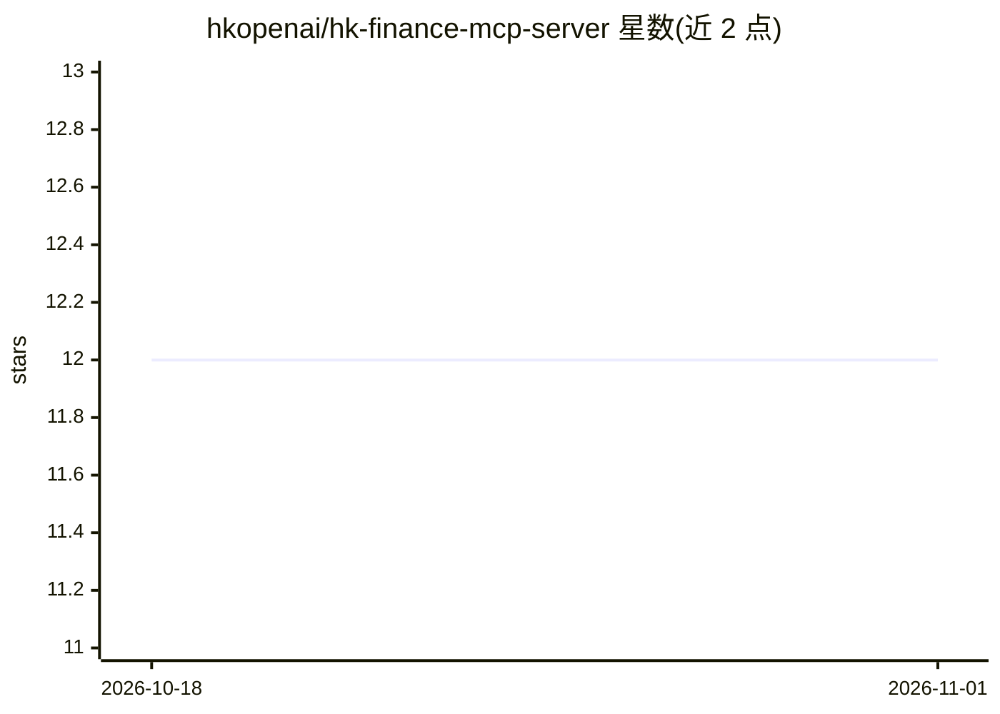

# hkopenai/hk-finance-mcp-server

⭐ 12 · Python · MIT · 推送 2026-10-02 · [GitHub](https://github.com/hkopenai/hk-finance-mcp-server) · 组织维护

**为 LLM/agent 提供香港金融数据的 MCP 服务器**

基于 FastMCP 实现的 MCP 服务器，向 AI 客户端（如 Cline）提供香港金融数据访问：涵盖商业登记统计、负资产住宅按揭、信用卡贷款调查、HIBOR 日利率、ATM 与银行分行位置、欺诈银行网站通报、股票印花税统计等 11 类工具。数据来源为香港金管局（HKMA）与税务局的 DataGovHK 开放数据接口。以 Python 源码形式运行，支持 stdio 与 SSE（端口 8000）两种模式，附带 pytest 测试目录。

## 筛选速览

| 维度 | 判定 | 备注 |
|---|---|---|
| AI 角色 | `ai-ecosystem` | LLM/agent 周边工具 |
| 许可风险 | `permissive` | MIT |
| 部署形态 | `library` | 以包/库形式分发 |
| 模型依赖 | — | README 未给出锁定关系 |
| 硬件要求 | — | 无带数字的原话,不猜 |
| 安装摩擦 | `low` | 无编译、无系统依赖或容器化 |
| 成熟度 | — | 结构信号不足 |

## 能力要点

- 11 类香港金融数据工具（商业登记、负资产按揭、HIBOR、ATM/分行定位等）
- FastMCP 实现，支持 stdio 与 SSE 两种运行模式
- 提供 Cline 集成配置说明
- 数据来自 HKMA 与香港税务局开放数据

## 适用场景

- 让 AI 编程助手或 agent 直接查询香港金融监管数据
- 基于 HIBOR、按揭与贷款调查数据生成分析或评论
- 查询银行分行/ATM 位置与欺诈网站通报

## 场景标签

`金融量化` · 领域:学习与行业

## 证据(README 行号)

> L6: This is an MCP server that provides access to finance related data in Hong Kong through a FastMCP interface.
> L64: To connect this MCP server to Cline using stdio:

## 星数曲线

2026-10-18 12 → 2026-11-01 12（+0）

---
*卡片 v1 · prompt 1.4 · 生成 2026-11-01 · 置信度 mid · 依据 README sha `bac92bc39e24` · [字段定义](../../DATASET.md)*
