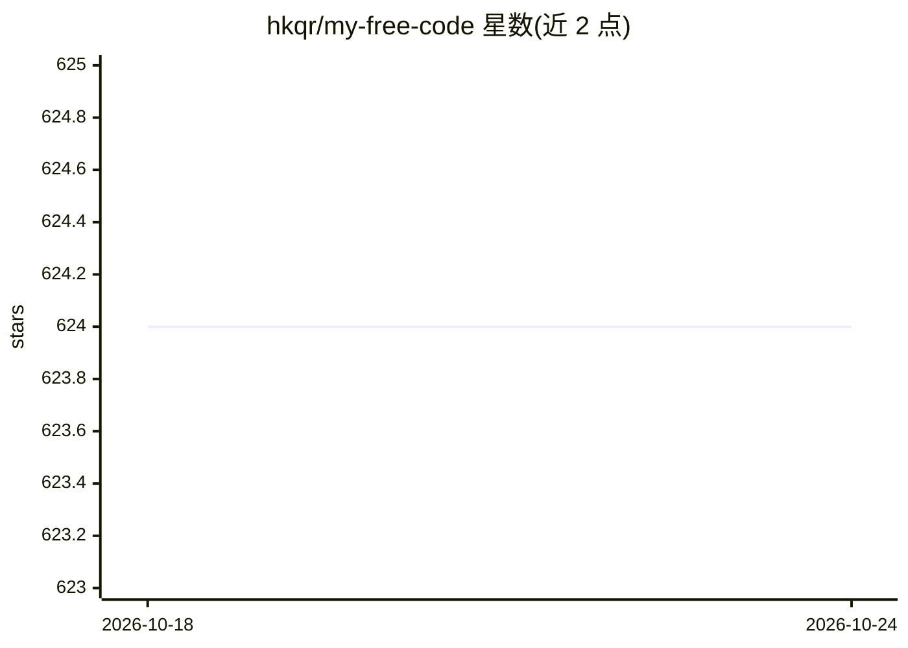

# hkqr/my-free-code

⭐ 624 · Python · MIT · 推送 2026-10-20 · [GitHub](https://github.com/hkqr/my-free-code) · 个人维护

**面向编码代理的多供应商 AI 网关，支持路由与本地模型**

用 Python 实现的本地多供应商网关：对外提供 Anthropic Messages、OpenAI Responses 兼容协议、模型发现与健康检查接口，将 Claude Code、Codex、Cline 等编码代理的请求路由到目录中约 40 个上游供应商（OpenRouter、DeepSeek、Groq、NVIDIA NIM 等）或 Ollama/LM Studio/llama.cpp 本地模型。功能包括流式 SSE、工具调用、推理元数据透传、Claude 档位路由、有序模型回退、供应商健康退避与并发控制，并带本地 Admin UI/API。通过 venv + requirements.txt 从源码运行，要求 Python 3.11+，声明仅面向本地使用。

## 筛选速览

| 维度 | 判定 | 备注 |
|---|---|---|
| AI 角色 | `ai-ecosystem` | LLM/agent 周边工具 |
| 许可风险 | `permissive` | MIT |
| 部署形态 | `library` | 以包/库形式分发 |
| 模型依赖 | local-ok | 支持本地模型 |
| 硬件要求 | — | 无带数字的原话,不猜 |
| 安装摩擦 | `low` | 无编译、无系统依赖或容器化 |
| 成熟度 | — | 结构信号不足 |

## 能力要点

- Anthropic Messages 与 OpenAI Responses 兼容协议端点
- 约 40 个上游供应商目录与有序模型回退
- Claude Code/Codex/Cline 等 9 种编码代理启动器适配
- 支持 Ollama/LM Studio/llama.cpp 本地模型后端

## 适用场景

- 让 Claude Code 等编码代理接入其他供应商或本地模型
- 为编码请求配置档位路由与多模型回退
- 通过 Admin UI 本地查看网关状态与模型列表

## 场景标签

`模型网关` · 领域:Agent 开发

## 证据(README 行号)

> L3: **A multi-provider gateway for Claude Code and other coding agents.**
> L10: - Anthropic Messages: `/v1/messages`
> L35: NVIDIA NIM, OpenRouter, Groq, OpenAI, xAI, QwenCloud, Together, DeepInfra, SiliconFlow, Nebius, Chutes, Featherless

## 星数曲线

2026-10-18 624 → 2026-10-24 624（+0）

---
*卡片 v1 · prompt 1.4 · 生成 2026-10-18 · 置信度 mid · 依据 README sha `1ce2dfc9946b` · [字段定义](../../DATASET.md)*
