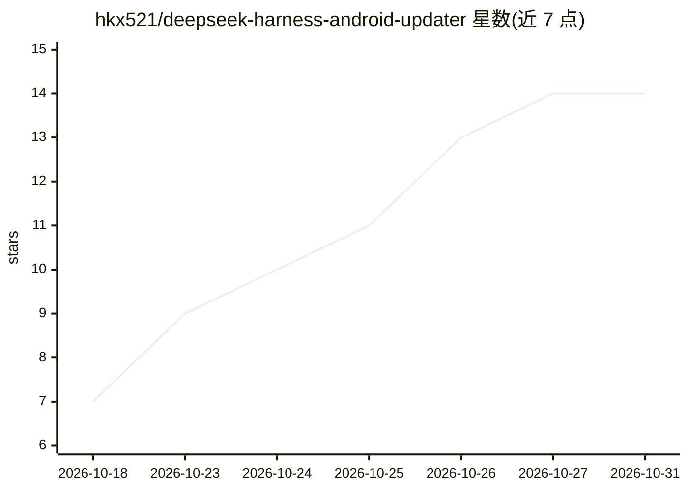

# hkx521/deepseek-harness-android-updater

⭐ 14 · Java · MIT · 推送 2026-09-22 · [GitHub](https://github.com/hkx521/deepseek-harness-android-updater) · 个人维护 · 中文 README

**把 DSH 内核打包成 APK，让 AI 通过 root/Shizuku 操作安卓手机**

将 DeepSeek Harness（DSH，@deepseek-ai/dsh 0.1.5-rc.1）打包为可直接安装的 Android APK。通过 root 的 su 通道或免 root 的 Shizuku 授予系统特权，使 AI 能装应用、点屏幕、改系统设置、截图与模拟输入；另有无需授权的无障碍读屏/操作通道与后台虚拟屏。提供定时任务、多任务管理、常驻引擎、模型路由降级（TTFT 哨兵）等功能；内置 40+ 手机端工具插件。要求 Android 7.0+，API Key 在 App 内填写仅存本机，首次启动解压运行资产约 1-3 分钟。

## 筛选速览

| 维度 | 判定 | 备注 |
|---|---|---|
| AI 角色 | `ai-native` | 本体是模型或模型工具 |
| 许可风险 | `permissive` | MIT |
| 部署形态 | `library` | 以包/库形式分发 |
| 模型依赖 | locked-api |  |
| 硬件要求 | — | 无带数字的原话,不猜 |
| 安装摩擦 | `low` | 无编译、无系统依赖或容器化 |
| 成熟度 | — | 结构信号不足 |

## 能力要点

- root 优先 / Shizuku 备用的特权通道，AI 可装应用、点屏幕、改系统设置
- 无障碍屏幕助手：无需 root/Shizuku 即可读屏、点击、输入、多指手势
- 后台虚拟屏让 AI 在独立屏幕操作 App，不抢主屏
- dsh-model-router 插件：首字超时哨兵与备用 provider 自动降级

## 适用场景

- 让 AI 代替我在手机上执行系统操作与应用自动化
- 设定时任务让 AI 到点自动执行并回填结果
- 不 root 的情况下让 AI 读屏并操作界面

## 场景标签

`GUI 自动化` `工作流自动化` · 领域:效率与自动化

## 证据(README 行号)

> L3: > 把 DeepSeek Harness（DSH）打包成**可直接安装的 Android APK** —— 装上就能用，还能让 AI **免 Root 真正操作手机**。
> L12: - 🔓 **免 Root 系统特权**：通过 Shizuku（或设备已有 root）打通系统 shell —— AI 能**装应用、点屏幕、改系统设置、截图、模拟输入**
> L27: - 🧠 **完整 DSH 内核**：`@deepseek-ai/dsh` 0.1.5-rc.1，保留插件生态 + RPC API，前端用 DSH 原生界面

## 星数曲线

2026-10-18 7 → 2026-10-31 14（+7）

---
*卡片 v1 · prompt 1.4 · 生成 2026-10-31 · 置信度 mid · 依据 README sha `7fe236d7012e` · [字段定义](../../DATASET.md)*
