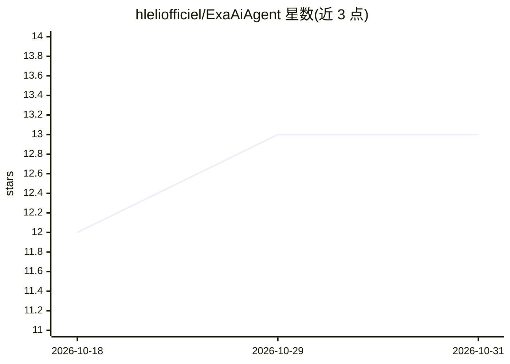

# hleliofficiel/ExaAiAgent

⭐ 13 · Python · Apache-2.0 · 推送 2026-07-21 · [GitHub](https://github.com/hleliofficiel/ExaAiAgent) · 个人维护

**AI 驱动的渗透测试 agent 框架，多 agent 协作与 Docker 沙箱执行**

面向开发者和安全团队的 AI 网络安全 agent：以多 agent 协作方式执行渗透测试，工具包括 HTTP 代理、浏览器自动化、终端环境、Python 运行时、侦察与 API 模糊测试等，检测 SQL 注入、XSS、SSRF、JWT、K8s RBAC 等 20 类漏洞，并通过实际 PoC 验证发现结果。工具在 Docker 沙箱中执行，支持多 LLM 后端（OpenAI/Anthropic/OpenRouter/Ollama 等），提供 CLI/TUI、headless 模式与 GitHub Actions 集成，另有 SKILL.md 供其他 AI agent 接管操作。需 Docker 与 Python 3.12+。

## 筛选速览

| 维度 | 判定 | 备注 |
|---|---|---|
| AI 角色 | `ai-native` | 本体是模型或模型工具 |
| 许可风险 | `permissive` | Apache-2.0 |
| 部署形态 | `library` | 以包/库形式分发 |
| 模型依赖 | local-ok | 支持本地模型 |
| 硬件要求 | — | 无带数字的原话,不猜 |
| 安装摩擦 | `low` | 无编译、无系统依赖或容器化 |
| 成熟度 | — | 结构信号不足 |

## 能力要点

- 多 agent 协作编排，20 个漏洞检测模块（含 K8s、prompt injection）
- 通过实际 PoC 验证漏洞以减少误报
- 工具在 Docker 沙箱中执行，首次运行自动拉取沙箱镜像
- 支持多 LLM 后端与 headless/CI 模式，SKILL.md 供外部 AI agent 操作

## 适用场景

- 自动化渗透测试并生成 PoC 验证
- Bug Bounty 研究与漏洞扫描自动化
- CI/CD 流水线中集成安全测试
- 云与容器（AWS/Azure/GCP/K8s）配置安全审计

## 场景标签

`网络安全` `多智能体` · 领域:Agent 开发

## 证据(README 行号)

> L5:  Advanced AI-Powered Cybersecurity Agent for Comprehensive Penetration Testing
> L79: ExaAiAgent is an elite AI-powered cybersecurity agent that acts like a real penetration tester - running your code 
> L88: - 🧠 **Multi-LLM Support** - OpenAI, Anthropic, Gemini, local models

## 星数曲线

2026-10-18 12 → 2026-10-31 13（+1）

---
*卡片 v1 · prompt 1.4 · 生成 2026-10-31 · 置信度 high · 依据 README sha `8f8b915d8c79` · [字段定义](../../DATASET.md)*
