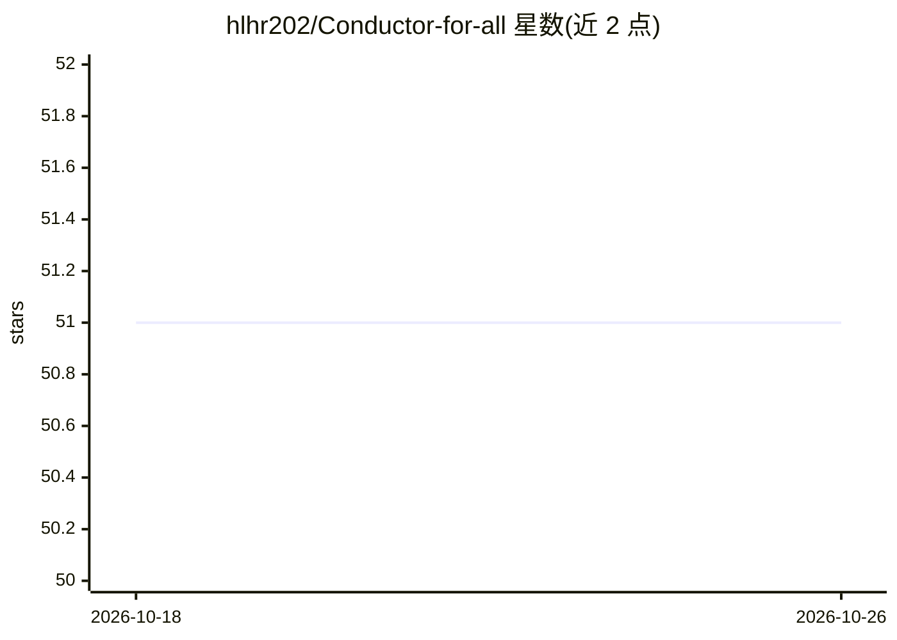

# hlhr202/Conductor-for-all

⭐ 51 · TypeScript · Apache-2.0 · 推送 2026-05-10 · [GitHub](https://github.com/hlhr202/Conductor-for-all) · [官网](https://www.npmjs.com/package/conductor-4-all) · 个人维护 · 中文 README

**将 Conductor 规范驱动开发方法安装到任意 AI 编码代理的 CLI 工具**

独立命令行工具（npm 包 conductor-4-all），将原本绑定 Gemini CLI 的 Conductor 规范驱动开发方法论解耦：通过 npx installer 向项目安装 Conductor 命令文件与工作流模板，支持 Skills 模式（agentskills.io 风格技能文件）与 Slash Commands 两种格式。安装时可选择 Opencode、Claude Code、Cursor、Codex、Windsurf、Cline 等 9 种 AI 编码代理。提供 setup/newTrack/implement/status/review/revert 等工作流命令。README 声明维护者建议迁移至 hlhr202/swe-skills。

## 筛选速览

| 维度 | 判定 | 备注 |
|---|---|---|
| AI 角色 | `ai-ecosystem` | LLM/agent 周边工具 |
| 许可风险 | `permissive` | Apache-2.0 |
| 部署形态 | `library` | 以包/库形式分发 |
| 模型依赖 | — | README 未给出锁定关系 |
| 硬件要求 | — | 无带数字的原话,不猜 |
| 安装摩擦 | `low` | 无编译、无系统依赖或容器化 |
| 成熟度 | — | 结构信号不足 |

## 能力要点

- npx conductor-4-all install 一键初始化项目
- Skills 与 Slash Commands 两种安装格式，Skills 为推荐默认
- 支持 9 种 AI 编码代理（Opencode/Claude Code/Cursor/Codex/Windsurf/Cline 等）
- 提供 6 个 Conductor 工作流命令（setup/newTrack/implement/status/review/revert）

## 适用场景

- 在 Claude Code 或 Cursor 等任意代理中使用 Conductor 规范驱动开发流程
- 以技能文件形式让多代理发现并复用 Conductor 工作流
- 为项目搭建结构化的功能轨道与实现/评审流程

## 场景标签

 · 领域:软件开发工具/AI 编码代理

## 证据(README 行号)

> L14: **Conductor for All** is a standalone command-line tool designed to bring the Conductor spec-driven development met
> L16: Originally tied to the Gemini CLI extension, this project aims to decouple the methodology, allowing developers to 
> L28: - **What "Skills" does:** Installs Conductor as agentskills.io–style skill files (or agent-specific skill directori

## 星数曲线

2026-10-18 51 → 2026-10-26 51（+0）

---
*卡片 v1 · prompt 1.4 · 生成 2026-10-24 · 置信度 high · 依据 README sha `be85aadac5c8` · [字段定义](../../DATASET.md)*
