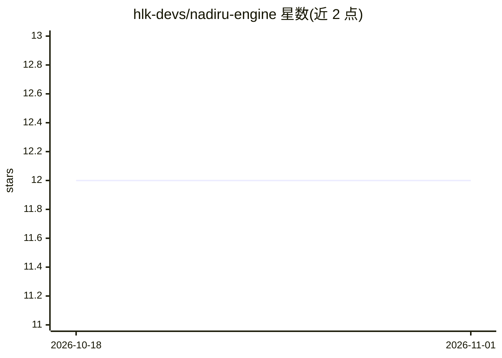

# hlk-devs/nadiru-engine

⭐ 12 · Python · MIT · 推送 2026-05-18 · [GitHub](https://github.com/hlk-devs/nadiru-engine) · [官网](https://nadiru.com) · 组织维护

**AI 编排引擎：按任务类型与历史效果在 400+ 模型间路由请求**

以 FastAPI 实现的本地编排引擎：收到 prompt 后由一个可选的 Conductor 小模型分类任务，按成本、质量与历史表现选择 provider 与模型并转发请求；记录每次交互的延迟、成本、拒绝与重试信号用于调整后续路由。内置 15+ provider 适配器（Ollama、Anthropic、OpenAI、Google 等），任何 OpenAI 兼容 API 可通过环境变量接入。提供 REST API（含 SSE 流式）、客户端注册机制与配套示例仓库。通过 git clone + pip 安装运行，需至少一个 provider key。

## 筛选速览

| 维度 | 判定 | 备注 |
|---|---|---|
| AI 角色 | `ai-ecosystem` | LLM/agent 周边工具 |
| 许可风险 | `permissive` | MIT |
| 部署形态 | `library` | 以包/库形式分发 |
| 模型依赖 | local-ok | 支持本地模型 |
| 硬件要求 | — | 无带数字的原话,不猜 |
| 安装摩擦 | `low` | 无编译、无系统依赖或容器化 |
| 成熟度 | — | 结构信号不足 |

## 能力要点

- Conductor 小模型对每个 prompt 分类并决定路由目标，Conductor 本身可任选 15+ provider 之一
- 从重试、延迟、成本、拒绝等信号学习各模型在不同任务上的表现
- 模型拒绝时可在限制更少的 provider 上自动重试一次
- 15+ 内置 provider 适配器，OpenAI 兼容 API 经环境变量注册接入

## 适用场景

- 同时持有多个 AI 订阅与本地模型，希望按任务自动选模型省成本
- 希望请求在模型拒绝时自动换 provider 重试
- 需要按客户端记录交互历史并审计每次路由原因与成本

## 场景标签

`模型网关` · 领域:Agent 开发

## 证据(README 行号)

> L5: You send it a prompt. A Conductor LLM classifies what kind of task it is, picks the right provider and model based o
> L33: **It's actually provider-agnostic.** 15+ adapters built in. Any OpenAI-compatible API drops in by adding an env var

## 星数曲线

2026-10-18 12 → 2026-11-01 12（+0）

---
*卡片 v1 · prompt 1.4 · 生成 2026-11-01 · 置信度 mid · 依据 README sha `770d211de889` · [字段定义](../../DATASET.md)*
