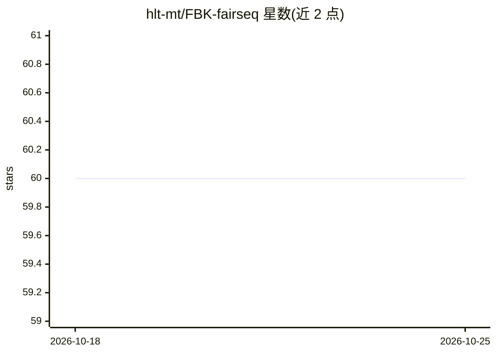

# hlt-mt/FBK-fairseq

⭐ 60 · Python · NOASSERTION · 推送 2026-03-19 · [GitHub](https://github.com/hlt-mt/FBK-fairseq) · 组织维护

**FBK 机器翻译组的论文开源代码集合，基于 fairseq**

意大利 FBK 研究所 MT 组论文配套代码仓库，收录 2021-2025 年在 ACL、EMNLP、IWSLT、INTERSPEECH 等会议发表的语音翻译、语音识别、自动字幕、同声传译、性别偏差控制等工作的实现，每项工作在 fbk_works 目录下有专属 README。底层基于 fairseq 序列建模工具包，提供 pip 可编辑安装方式。限制：仅测试到 Python 3.8，不兼容较新 Python 版本。面向希望复现论文结果的机器翻译与语音处理研究者。

## 筛选速览

| 维度 | 判定 | 备注 |
|---|---|---|
| AI 角色 | `ai-native` | 本体是模型或模型工具 |
| 许可风险 | `none` | NOASSERTION |
| 部署形态 | `self-host` | docker 或自建部署 |
| 模型依赖 | — | README 未给出锁定关系 |
| 硬件要求 | — | 无带数字的原话,不猜 |
| 安装摩擦 | `low` | 无编译、无系统依赖或容器化 |
| 成熟度 | — | 结构信号不足 |

## 能力要点

- 覆盖 2021-2025 年约 25 项发表工作的实现
- 基于 fairseq，pip install -e . 本地安装
- 含 FAMA 英语/意大利语开放科学语音基础模型
- 每项工作附独立 README 与 Bibtex 引用

## 适用场景

- 复现 FBK 发表的语音翻译/同传/字幕论文结果
- 在 fairseq 基础上研究性别可控的语音翻译
- 参考语音基础模型 FAMA 的训练代码

## 场景标签

`语音识别` `科研工具` · 领域:学习与行业

## 证据(README 行号)

> L7: This repository contains the open source code by the MT unit of FBK.
> L19:  - **SPES: Spectrogram Perturbation for Explainable Speech-to-Text Generation**

## 星数曲线

2026-10-18 60 → 2026-10-25 60（+0）

---
*卡片 v1 · prompt 1.4 · 生成 2026-10-24 · 置信度 mid · 依据 README sha `3aa255c926e6` · [字段定义](../../DATASET.md)*
