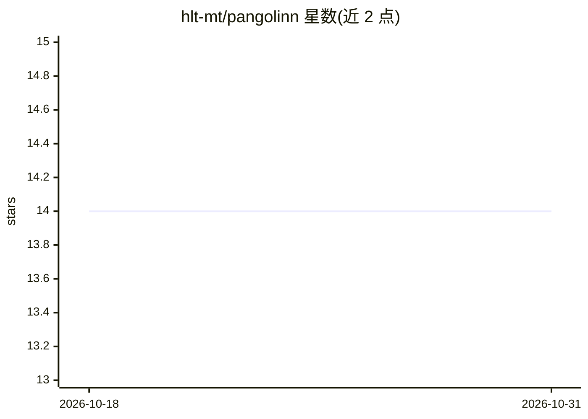

# hlt-mt/pangolinn

⭐ 14 · Python · Apache-2.0 · 推送 2026-04-29 · [GitHub](https://github.com/hlt-mt/pangolinn) · [官网](https://pangolinn.readthedocs.io/) · 组织维护

**神经网络单元测试框架：检测模型中的 bug**

面向开发者与科研人员的 Python 单元测试库，用于发现神经网络和新构建模型中的缺陷。机制上通过为待测模块创建 wrapper 并继承内置 tester 构建测试套件；目前提供两个测试套件：encoder padding tester（验证 padding 不影响结果）与 causality tester（验证模块不读取序列未来元素，适用于自回归 decoder）。通过 pip 安装，Apache 2.0 许可，出自 NLP 软件质量相关论文团队，欢迎社区贡献新测试。

## 筛选速览

| 维度 | 判定 | 备注 |
|---|---|---|
| AI 角色 | `ai-ecosystem` | LLM/agent 周边工具 |
| 许可风险 | `permissive` | Apache-2.0 |
| 部署形态 | `library` | 以包/库形式分发 |
| 模型依赖 | — | README 未给出锁定关系 |
| 硬件要求 | — | 无带数字的原话,不猜 |
| 安装摩擦 | `low` | 无编译、无系统依赖或容器化 |
| 成熟度 | — | 结构信号不足 |

## 能力要点

- Encoder padding tester：验证 padding 不改变输出结果
- Causality tester：验证模块满足因果性（不读取未来元素）
- 基于 wrapper + tester 继承的测试组织方式

## 适用场景

- 为自研 Transformer decoder 验证因果掩码正确性
- 检查编码器对 padding 的处理是否影响结果
- 为新模型编写可复用的单元测试

## 场景标签

 · 领域:机器学习工程/测试工具

## 证据(README 行号)

> L5: As a Pangolin looks for bugs and catches them, the goal of this
> L34:  - create a test suite that inherits from the pangolinn tester you want to use and

## 星数曲线

2026-10-18 14 → 2026-10-31 14（+0）

---
*卡片 v1 · prompt 1.4 · 生成 2026-10-31 · 置信度 high · 依据 README sha `d03da404112b` · [字段定义](../../DATASET.md)*
