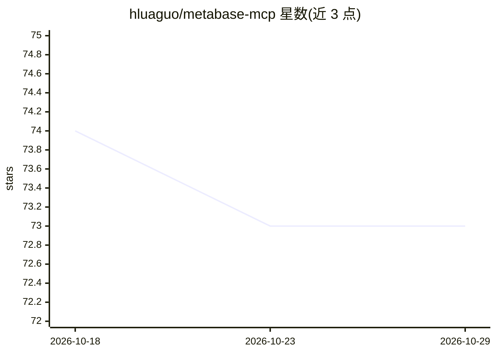

# hluaguo/metabase-mcp

⭐ 73 · Python · MIT · 推送 2026-04-13 · [GitHub](https://github.com/hluaguo/metabase-mcp) · 个人维护

**让 Claude 等 MCP 客户端操作 Metabase 分析数据的 MCP 服务器**

基于 FastMCP 的 Model Context Protocol 服务器，作为 Metabase API 与对话式 AI 之间的桥接层：面向 Claude Desktop、Cursor 等 MCP 客户端提供 list_databases、execute_query、execute_mongodb_query、卡片与集合管理等 11 类工具，支持自然语言转 SQL/MongoDB 查询。认证支持 Metabase API Key 与会话式邮箱密码，凭据经 .env 管理。传输方式含 STDIO（默认）/SSE/HTTP，需 Python 3.12+ 与可访问 API 的 Metabase 实例，可通过 uvx 直接运行或从 PyPI 安装。

## 筛选速览

| 维度 | 判定 | 备注 |
|---|---|---|
| AI 角色 | `ai-ecosystem` | LLM/agent 周边工具 |
| 许可风险 | `permissive` | MIT |
| 部署形态 | `library` | 以包/库形式分发 |
| 模型依赖 | — | README 未给出锁定关系 |
| 硬件要求 | — | 无带数字的原话,不猜 |
| 安装摩擦 | `low` | 无编译、无系统依赖或容器化 |
| 成熟度 | — | 结构信号不足 |

## 能力要点

- 提供 11 个工具覆盖数据库浏览、SQL/MongoDB 查询执行、卡片与集合管理
- 支持 Metabase API Key 与邮箱密码两种认证，凭据经 .env 配置
- STDIO/SSE/HTTP 三种传输方式，兼容所有 MCP 客户端
- 可用 uvx 免安装直接运行

## 适用场景

- 用自然语言让 AI 助手查询 Metabase 数据库并生成 SQL
- 通过 AI 自动创建和管理 Metabase 卡片、集合与仪表盘
- 在 Cursor 或 Claude Desktop 中集成 BI 数据分析工作流

## 场景标签

`数据分析` · 领域:效率与自动化

## 证据(README 行号)

> L8: A high-performance **Model Context Protocol (MCP) server** for **Metabase**, enabling AI assistants like **Claude**,
> L34: - **Any MCP Client**: Compatible with all Model Context Protocol clients

## 星数曲线

2026-10-18 74 → 2026-10-29 73（-1）

---
*卡片 v1 · prompt 1.4 · 生成 2026-10-24 · 置信度 mid · 依据 README sha `f9b55cc519a9` · [字段定义](../../DATASET.md)*
