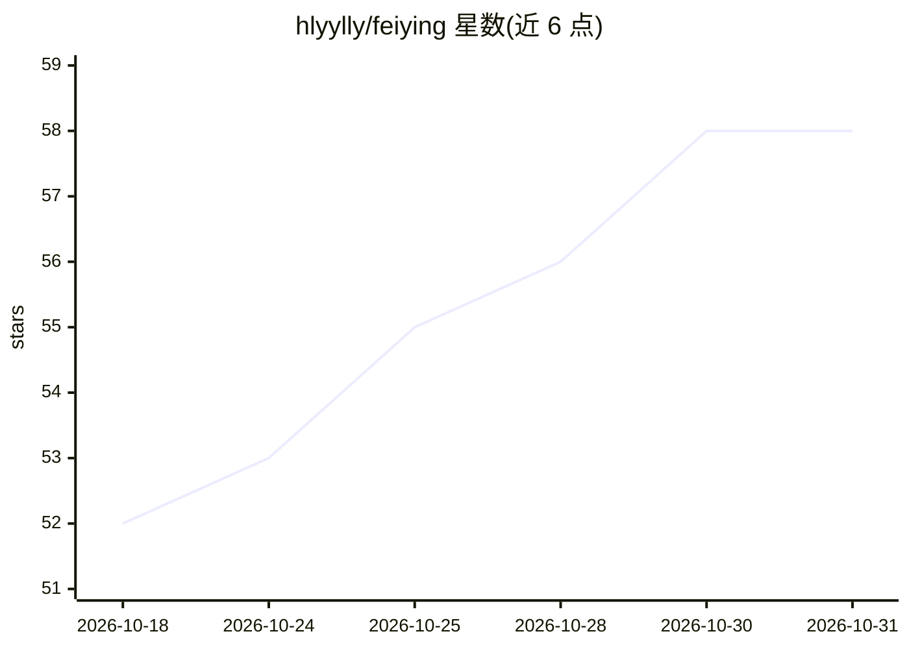

# hlyylly/feiying

⭐ 58 · Python · MIT · 推送 2026-09-21 · [GitHub](https://github.com/hlyylly/feiying) · 个人维护 · 中文 README

**发片名即从 Telegram 自动搜片入库并流播的自托管工具**

面向 NAS/桌面/移动用户的自托管媒体工具：输入片名（支持自然语言描述），从 Telegram 频道与 bot 搜索资源，用 deepseek 做正片匹配与集数解析（key 留空则退化为正则匹配），生成 .strm 入库到飞牛影视/Emby/Jellyfin，支持缓存流播、断点续缓、剧集自动追更，内置 xray 连接 Telegram。提供 Docker Compose、飞牛 fpk、Windows 免安装 exe、Android APK 四种部署形态。要求用户提供 TG 账户、资源 bot、代理方式与 deepseek API key。

## 筛选速览

| 维度 | 判定 | 备注 |
|---|---|---|
| AI 角色 | `ai-enhanced` | 去掉 AI 部分产品仍成立 |
| 许可风险 | `permissive` | MIT |
| 部署形态 | `desktop` | 安装包/桌面程序 |
| 模型依赖 | locked-api |  |
| 硬件要求 | — | 无带数字的原话,不猜 |
| 安装摩擦 | `low` | 无编译、无系统依赖或容器化 |
| 成熟度 | — | 结构信号不足 |

## 能力要点

- 自然语言片名理解与 deepseek 智能匹配（可退化为正则）
- 缓存流播：多连接预取、LRU 淘汰、剧集滚动预取
- 剧集自动追更，定时查新只补新增
- 四种部署形态：fpk/Docker/Windows exe/Android APK（含 TV 大屏模式）

## 适用场景

- NAS 上配合 Emby/Jellyfin/飞牛影视实现发片名即入库秒播
- 追剧集时自动补新集并查看更新记录
- Windows/Android 设备上直接用内置播放器观看

## 场景标签

`工作流自动化` · 领域:效率与自动化

## 证据(README 行号)

> L20: - 🧠 **AI 智能匹配**（deepseek）：从一堆杂乱结果里挑出正确的正片，解析集数，自然语言片名理解，排除盗名/预告/花絮等无关结果
> L31: 4. **一个 deepseek API key**（AI 匹配；留空则退化为正则匹配）

## 星数曲线

2026-10-18 52 → 2026-10-31 58（+6）

---
*卡片 v1 · prompt 1.4 · 生成 2026-10-24 · 置信度 high · 依据 README sha `0b16473c6dc2` · [字段定义](../../DATASET.md)*
