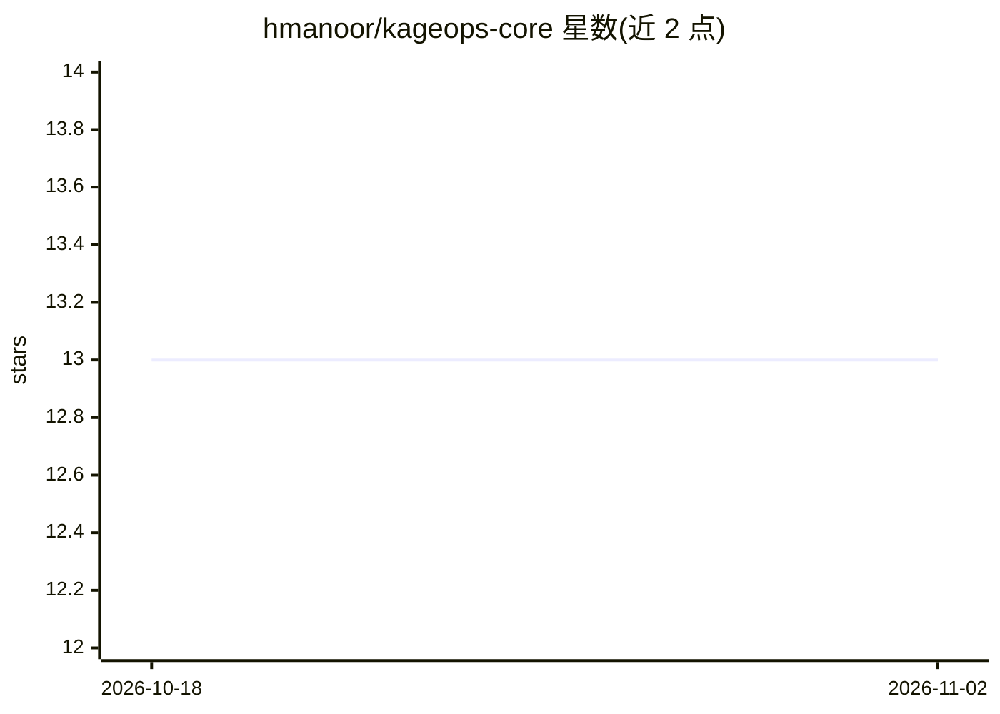

# hmanoor/kageops-core

⭐ 13 · TypeScript · NOASSERTION · 推送 2026-08-01 · [GitHub](https://github.com/hmanoor/kageops-core) · [官网](https://kageops.dev) · 个人维护

**开源自主 AI 开发团队：从一句话需求到交付可运行产品**

由 Sensei 编排器调度八个专业 agent（Scout/Blueprint/Pixel/Forge 等），按发现→POC→可行性→设计→开发→上线六阶段流程分解并执行任务，产出经过构建验证（真实 npm install/build/test）与验收门（对照需求简报）的项目。提供 Electron 桌面端 Command Center、headless CLI 与 dry-run 模式；强制 USD 预算上限与 kill-switch，内嵌 PGlite 数据库，无需 Docker。AGPL-3.0 开源核心，商业云层在另一私有仓库。

## 筛选速览

| 维度 | 判定 | 备注 |
|---|---|---|
| AI 角色 | `ai-native` | 本体是模型或模型工具 |
| 许可风险 | `none` | NOASSERTION |
| 部署形态 | `library` | 以包/库形式分发 |
| 模型依赖 | local-ok | 支持本地模型 |
| 硬件要求 | — | 无带数字的原话,不猜 |
| 安装摩擦 | `low` | 无编译、无系统依赖或容器化 |
| 成熟度 | — | 结构信号不足 |

## 能力要点

- Sensei 编排器 + 8 个专业 agent，六阶段生命周期与阶段门
- BuildVerificationGate 真实执行 npm install/build/test，AcceptanceGate 对照简报验收
- 强制 KAGEOPS_MAX_RUN_USD 预算上限，每 3 秒轮询并在超支前取消运行
- 多 provider 适配：Claude / OpenRouter / Ollama（全本地）/ OpenAI / Gemini

## 适用场景

- 用一句话需求让多 agent 生成并验证完整项目
- 在本地笔记本上以预算上限受控地运行自主开发 agent
- 通过桌面端实时观察、拦截、审批各 agent 任务

## 场景标签

`多智能体` `编码 Agent` · 领域:Agent 开发

## 证据(README 行号)

> L24: You describe what you want. **Sensei** — the orchestrator — decomposes it into
> L30: > decomposition, phase gates, a build gate that actually runs `npm install/build/test`,
> L130: - 🔌 **Bring your own provider.** Claude (API + CLI), OpenRouter, **Ollama

## 星数曲线

2026-10-18 13 → 2026-11-02 13（+0）

---
*卡片 v1 · prompt 1.4 · 生成 2026-10-31 · 置信度 high · 依据 README sha `094ff4942833` · [字段定义](../../DATASET.md)*
