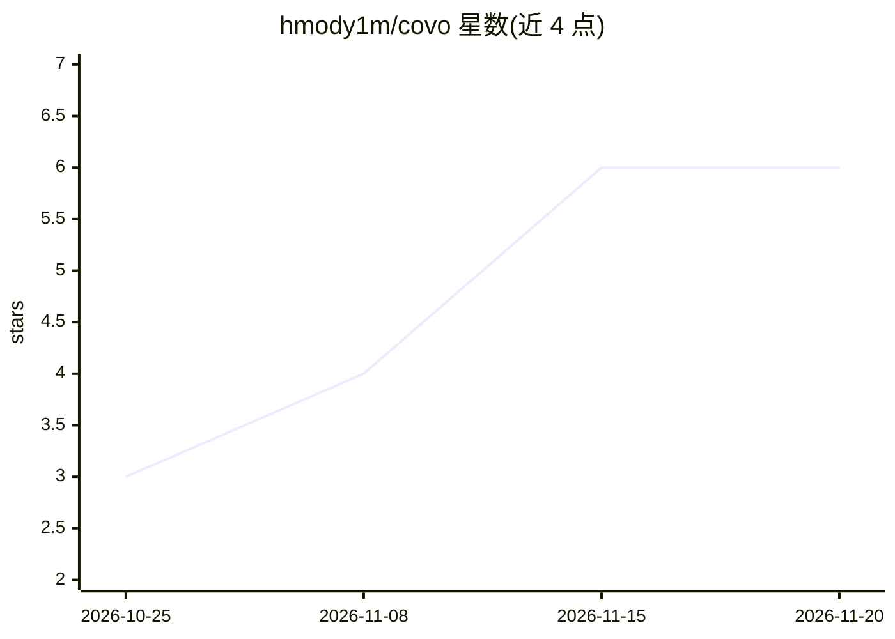

# hmody1m/covo

⭐ 6 · JavaScript · MIT · 推送 2026-10-23 · [GitHub](https://github.com/hmody1m/covo) · 组织维护

**自托管自主 AI agent：执行任务、后台例程与审批式自动化**

Covo 是一个可自托管的自主 AI agent，端到端执行任务：工具调用循环、后台任务、定时例程（晨间简报）、长期记忆、MCP 服务器、网页搜索、shell/文件操作与设备控制。操作分 Ask/Auto/Block 三级审批，提供可编辑系统提示词与可撤销令牌。提供五种形态：Windows/macOS/Linux 桌面应用（Electron）、Android 应用（Capacitor）、浏览器 PWA 与服务器版（npm/Docker/VPS）。默认接 Claude（用户自备 API key），也可接任意 OpenAI 兼容模型，含免 key 演示。MIT 协议，无遥测。

## 筛选速览

| 维度 | 判定 | 备注 |
|---|---|---|
| AI 角色 | `ai-native` | 本体是模型或模型工具 |
| 许可风险 | `permissive` | MIT |
| 部署形态 | `desktop` | 安装包/桌面程序 |
| 模型依赖 | local-ok | 支持本地模型 |
| 硬件要求 | — | 无带数字的原话,不猜 |
| 安装摩擦 | `medium` | 含编译或系统依赖之一 |
| 成熟度 | — | 结构信号不足 |

## 能力要点

- 自主 agent：工具循环、后台任务、定时例程、长期记忆、MCP 服务器
- 审批门控：按类别 Ask/Auto/Block、三级自治、沙箱化产物
- 一份代码五个版本：桌面、Android、浏览器 PWA、服务器、设备 runner
- 支持 Claude API key 或 OpenAI 兼容端点，附带免 key 演示

## 适用场景

- 自建一个每天晨报并在后台持续处理任务的私人 agent
- 对涉及付款、发消息、改文件的 AI 操作保留人工审批
- 在 VPS 上常驻 agent，用手机或桌面多端接入

## 场景标签

`AI 助手` `工作流自动化` · 领域:效率与自动化

## 证据(README 行号)

> L5: **An open-source alternative to Claude Duet** — a self-hosted autonomous AI agent that runs things end to end,
> L9: or OpenAI-compatible model (Ollama, LM Studio, OpenRouter). Give it tools, routines and approvals, and it does
> L60: - **A real autonomous agent.** Full tool loop, background tasks, scheduled routines (morning brief), long-term memo

## 星数曲线

2026-10-25 3 → 2026-11-20 6（+3）

---
*卡片 v1 · prompt 1.4 · 生成 2026-11-20 · 置信度 high · 依据 README sha `682ae4a77ef0` · [字段定义](../../DATASET.md)*
