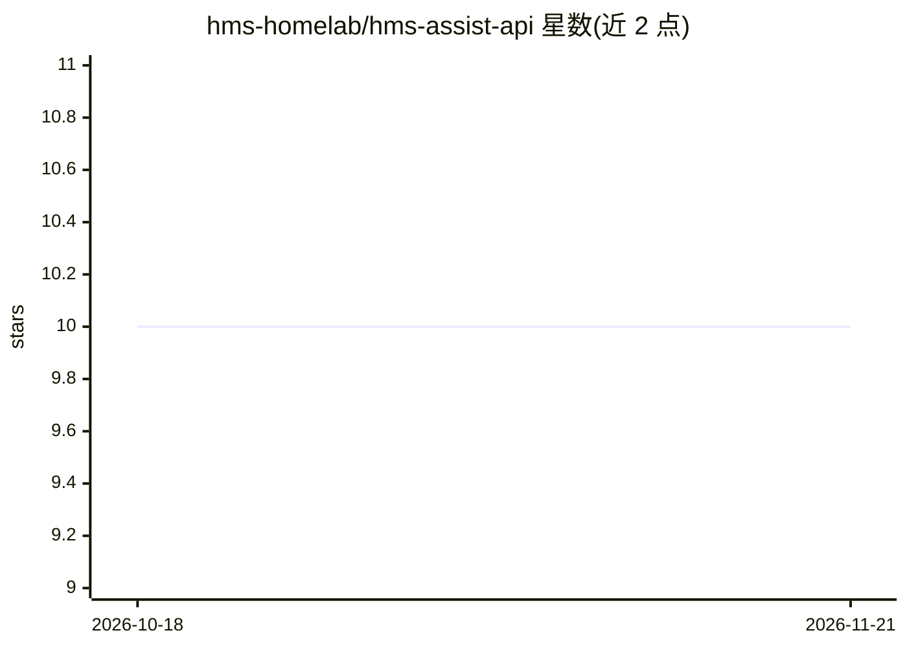

# hms-homelab/hms-assist-api

⭐ 10 · C++ · MIT · 推送 2026-06-09 · [GitHub](https://github.com/hms-homelab/hms-assist-api) · [官网](https://shmaestro.com/projects/assist) · 个人维护

**本地语音助手后端：三级意图分类控制 Home Assistant**

C++ 实现的语音助手 API 后端，属 maestro-hub 家庭自动化平台的一部分。接收自然语言命令文本，经三级分类管线处理：Tier 1 正则匹配（<5ms）、Tier 2 基于 nomic-embed-text 向量检索 pgvector 实体索引（约 300ms，含传感器直读）、Tier 3 调用 LLM 处理复杂/模糊请求（1–40s），执行对应 Home Assistant 动作并返回结构化结果，全程本地运行无需云端。依赖 PostgreSQL 17 + pgvector、Ollama（llama3.2:3b）等，经 Docker 或源码构建脚本安装，注册为 systemd 服务运行。

## 筛选速览

| 维度 | 判定 | 备注 |
|---|---|---|
| AI 角色 | `ai-native` | 本体是模型或模型工具 |
| 许可风险 | `permissive` | MIT |
| 部署形态 | `self-host` | docker 或自建部署 |
| 模型依赖 | local-ok | 支持本地模型 |
| 硬件要求 | — | 无带数字的原话,不猜 |
| 安装摩擦 | `low` | 无编译、无系统依赖或容器化 |
| 成熟度 | — | 结构信号不足 |

## 能力要点

- 三级意图分类管线：正则→向量检索→LLM，按复杂度分流
- Tier 2 向量索引 1115 个 HA 实体，传感器查询不经 LLM 直接返回状态
- 支持通过 HA 媒体播放器朗读响应文本（TTS）
- 实体同步工具每 60 分钟从 HA 拉取并嵌入实体描述

## 适用场景

- 家庭自动化中用自然语言控制灯光、温控、门锁与媒体播放
- 局域网内私有部署语音助手，不依赖云端服务
- 给 Home Assistant 补充语义化口语命令理解能力

## 场景标签

`语音 Agent` · 领域:对话与助手

## 证据(README 行号)

> L7: **100% local voice assistant API with 3-tier intent classification and Home Assistant integration.**
> L26: Accepts a natural-language voice command (text) via HTTP POST, classifies intent through a 3-tier pipeline, execute
> L81: ### Tier 3 — LLM (complex / ambiguous, 1–30s)

## 星数曲线

2026-10-18 10 → 2026-11-21 10（+0）

---
*卡片 v1 · prompt 1.4 · 生成 2026-11-20 · 置信度 high · 依据 README sha `c48812bfc461` · [字段定义](../../DATASET.md)*
