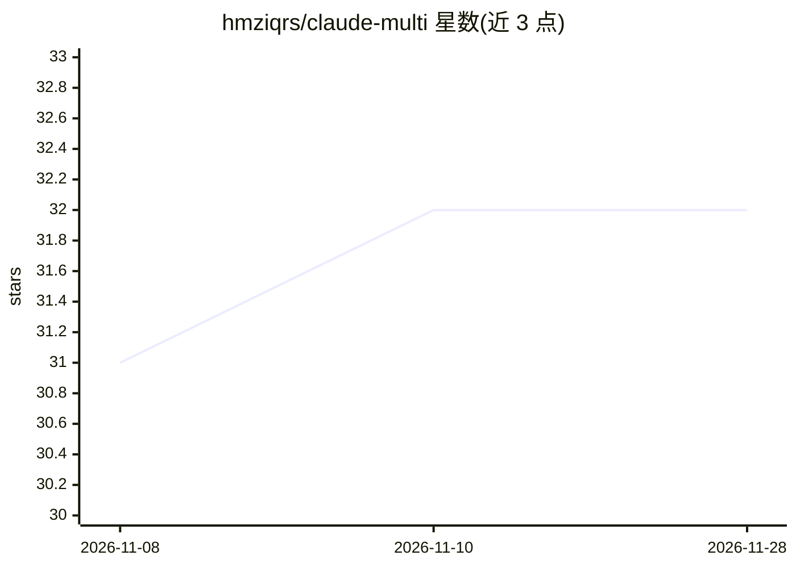

# hmziqrs/claude-multi

⭐ 32 · TypeScript · MIT · 推送 2026-11-03 · [GitHub](https://github.com/hmziqrs/claude-multi) · [官网](https://claude-multi.hmziq.xyz) · 个人维护

**并行运行多个隔离 Claude Code 实例的 CLI 管理工具**

面向同时使用多家模型服务商的开发者：为每个实例创建独立配置目录（~/.claude-<name>/）、包装脚本与 claude-<name> 命令，底层运行未修改的 claude 二进制。内置 GLM、MiniMax、DeepSeek、小米 MiMo、Kimi、通义千问等 8 个服务商模板，通过写入 ANTHROPIC_BASE_URL 等环境变量切换后端。提供终端 UI 向导、健康检查（doctor check/fix）与插件/技能符号链接同步。要求 Node.js 22+ 或 Bun 1+ 且已全局安装 Claude Code。

## 筛选速览

| 维度 | 判定 | 备注 |
|---|---|---|
| AI 角色 | `ai-ecosystem` | LLM/agent 周边工具 |
| 许可风险 | `permissive` | MIT |
| 部署形态 | `library` | 以包/库形式分发 |
| 模型依赖 | locked-api |  |
| 硬件要求 | — | 无带数字的原话,不猜 |
| 安装摩擦 | `low` | 无编译、无系统依赖或容器化 |
| 成熟度 | — | 结构信号不足 |

## 能力要点

- 8 个服务商模板（GLM/MiniMax/DeepSeek/MiMo/Kimi/Qwen）生成独立实例命令
- 每个实例独立配置目录、插件、MCP servers 与别名
- 运行未修改的 claude 二进制，不 fork 不打补丁
- doctor check/fix 检查并应用模板更新，保留用户自定义值

## 适用场景

- 在不同模型服务商之间快速切换并同时保留多套配置
- 避免手工编辑 settings.json 与管理环境变量
- 让一次安装的插件/技能出现在多个隔离实例中

## 场景标签

 · 领域:开发者工具/LLM 客户端管理

## 证据(README 行号)

> L5:  Run multiple isolated Claude Code instances side by side. Each one gets its own provider, config directory, plugins
> L72: Templates write `ANTHROPIC_BASE_URL`, `ANTHROPIC_MODEL`, and related env vars into `~/.claude-<name>/settings.json`

## 星数曲线

2026-11-08 31 → 2026-11-28 32（+1）

---
*卡片 v1 · prompt 1.4 · 生成 2026-11-18 · 置信度 high · 依据 README sha `424b337a0610` · [字段定义](../../DATASET.md)*
