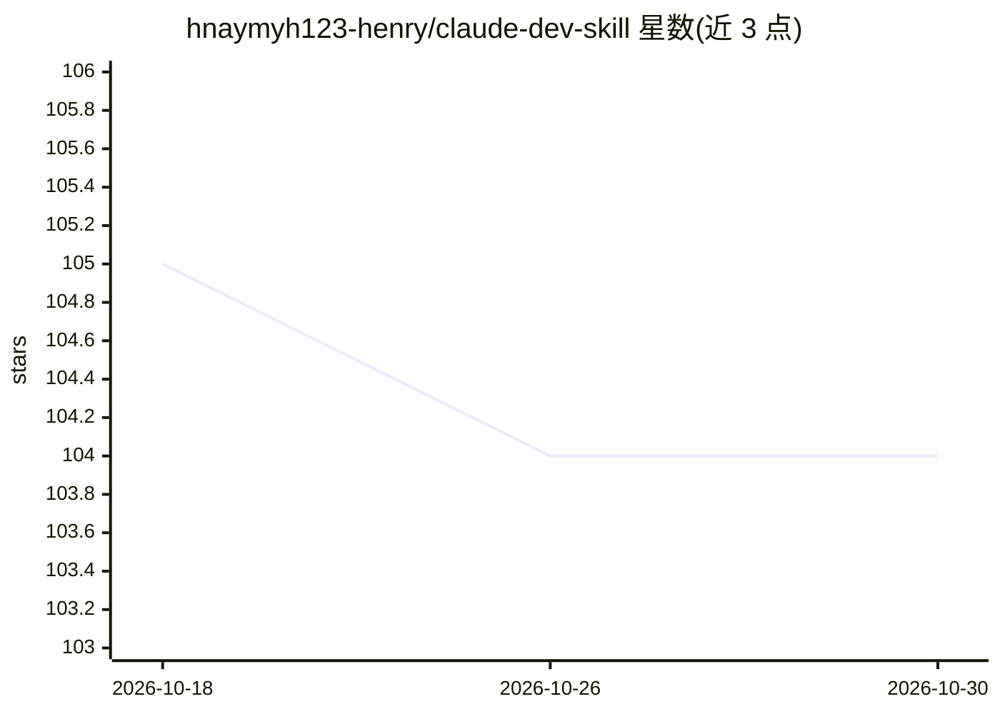

# hnaymyh123-henry/claude-dev-skill

⭐ 104 · MIT · 推送 2026-05-27 · [GitHub](https://github.com/hnaymyh123-henry/claude-dev-skill) · [官网](https://github.com/hnaymyh123-henry/claude-dev-skill) · 个人维护 · 中文 README

**让 Claude Code 扮演 Tech Lead 的多 Agent 开发 SOP 技能**

面向 Claude Code 的自定义技能（skill）：把 Claude 变成 Tech Lead，主对话不直接写代码，通过 6 阶段 SOP（请求分类、PRD 对齐、架构与任务分解、并行 Worker Agent 开发、代码审查、复盘）协调多个 Worker Agent 在隔离 worktree 中并行开发，直至 PR 合并。机制上提供编码前冲突扫描、6 类反例自检、bandit/pip-audit/npm audit 强制安全门与数据库迁移否决规则。需 Claude Code、GitHub CLI 与 Git；通过安装脚本或手动复制命令文件安装，在 Claude Code 中以 /dev 调用。声明不适用于生产部署、大规模数据迁移与高合规要求场景。

## 筛选速览

| 维度 | 判定 | 备注 |
|---|---|---|
| AI 角色 | `ai-ecosystem` | LLM/agent 周边工具 |
| 许可风险 | `permissive` | MIT |
| 部署形态 | `None` |  |
| 模型依赖 | — | README 未给出锁定关系 |
| 硬件要求 | — | 无带数字的原话,不猜 |
| 安装摩擦 | `low` | 无编译、无系统依赖或容器化 |
| 成熟度 | — | 结构信号不足 |

## 能力要点

- 6 阶段多 Agent 开发 SOP：从 PRD 对齐到 PR 合并
- Worker Agent 在隔离 worktree 中并行开发，编码前冲突扫描
- 强制安全门：bandit + pip-audit / npm audit
- 数据库 DDL 操作触发强制否决

## 适用场景

- 让 Claude Code 按工程流程并行开发中小型 Web 后端/API 项目
- 基于已有 PRD 系统化开发功能模块
- 多功能并行开发时提前规避合并冲突

## 场景标签

`多智能体` `编码 Agent` · 领域:Agent 开发

## 证据(README 行号)

> L11: A custom skill for Claude Code that turns Claude into a **Tech Lead** coordinating multiple AI Worker Agents throug
> L36: `/dev` is a **multi-agent software development SOP** covering:

## 星数曲线

2026-10-18 105 → 2026-10-30 104（-1）

---
*卡片 v1 · prompt 1.4 · 生成 2026-10-23 · 置信度 high · 依据 README sha `44c497488912` · [字段定义](../../DATASET.md)*
