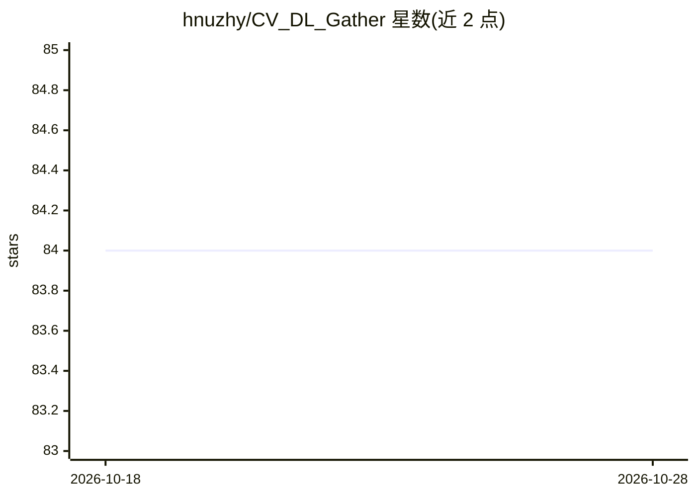

# hnuzhy/CV_DL_Gather

⭐ 84 · 推送 2026-10-12 · [GitHub](https://github.com/hnuzhy/CV_DL_Gather) · 个人维护

**计算机视觉深度学习方向的论文/代码/笔记聚合清单**

按研究主题组织的计算机视觉资源聚合仓库：覆盖行为识别、情感计算、人脸头部相关、模型压缩、目标检测、姿态估计、视觉跟踪等方向，每个主题给出定义与补充说明，并折叠收录相关论文、对应代码（如有）、阅读笔记等材料；另列出常覆盖主题与指向其他论文合集仓库（ECCV/CVPR/ICCV Papers-with-Code 等）的链接。内容以论文目录形式呈现，无可安装的软件本体。

## 筛选速览

| 维度 | 判定 | 备注 |
|---|---|---|
| AI 角色 | `ai-knowledge` | 知识聚合/清单类 |
| 许可风险 | `none` | — |
| 部署形态 | `None` |  |
| 模型依赖 | — | README 未给出锁定关系 |
| 硬件要求 | — | 无带数字的原话,不猜 |
| 安装摩擦 | `low` | 无编译、无系统依赖或容器化 |
| 成熟度 | — | 结构信号不足 |

## 能力要点

- 按 7 个 CV 研究主题组织的论文与代码聚合
- 每个主题附定义与补充说明（任务界定、方法分类）
- 汇总 ECCV/CVPR/ICCV 等会议的 Papers-with-Code 合集链接

## 适用场景

- 查找某个 CV 子方向（如姿态估计、模型压缩）的论文与对应代码
- 了解各 CV 任务的定义与方法分类作为入门参考
- 从合集跳转到会议论文与代码索引仓库

## 场景标签

`精选清单` · 领域:学习与行业

## 证据(README 行号)

> L3: ## ▶ Action Recognition
> L63: ## Other Collection Depository

## 星数曲线

2026-10-18 84 → 2026-10-28 84（+0）

---
*卡片 v1 · prompt 1.4 · 生成 2026-10-24 · 置信度 high · 依据 README sha `aef7e1308d77` · [字段定义](../../DATASET.md)*
