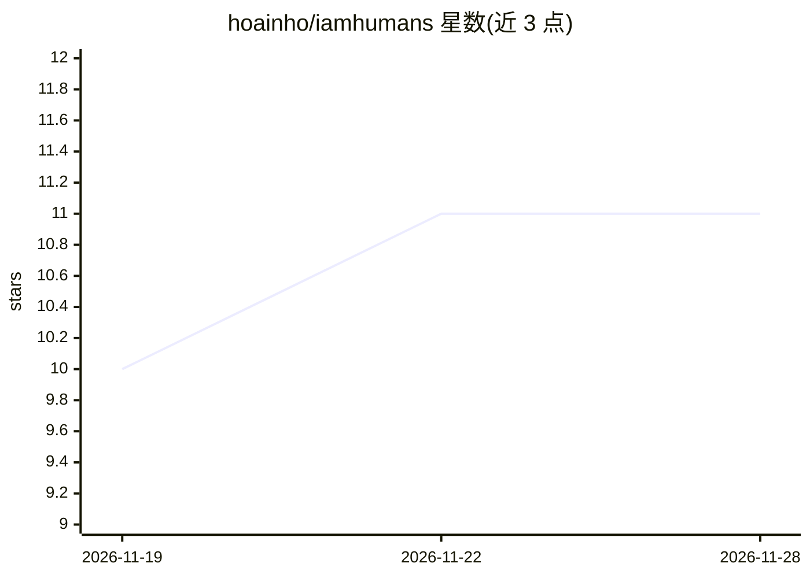

# hoainho/iamhumans

⭐ 11 · Python · MIT · 推送 2026-07-07 · [GitHub](https://github.com/hoainho/iamhumans) · [官网](https://hoainho.github.io/iamhumans/) · 个人维护

**教 LLM 以人的方式对话的便携 SKILL.md 技能**

一个单一 SKILL.md 文件形式的便携技能，面向 Claude Code、opencode 及任意 agent，用于教语言模型在人际对话中如何回应：含 Mode A（实时对话临场感）与 Mode B（AI 文本去机器味改写）两种模式，每次回复前运行 detect→repair→soul 自审流程，附带六类 AI-tell 分类法、16 个模块（约 304 条基于书籍的规则）与运行中的用户画像机制。配套 429 条案例的 eval 语料与评分 runner；作者声明评分样本仅 30 例且存在同源模型污染。安装无需运行时或依赖，git clone 后复制或粘贴到系统提示词即可。

## 筛选速览

| 维度 | 判定 | 备注 |
|---|---|---|
| AI 角色 | `ai-ecosystem` | LLM/agent 周边工具 |
| 许可风险 | `permissive` | MIT |
| 部署形态 | `None` |  |
| 模型依赖 | — | README 未给出锁定关系 |
| 硬件要求 | — | 无带数字的原话,不猜 |
| 安装摩擦 | `low` | 无编译、无系统依赖或容器化 |
| 成熟度 | — | 结构信号不足 |

## 能力要点

- 两种模式：对话临场感（Mode A）与 AI 文本去机器味改写（Mode B）
- 每次回复前的 detect→repair→soul 自审流程
- 16 模块约 304 条基于书籍的规则，附六类 AI-tell 分类法
- 429 条 eval 案例语料与评分 runner，README 公布含缺陷的样本得分

## 适用场景

- 让 agent 在情绪、关系类对话中按人的方式回复
- 把 AI 起草的文案改得更不像机器生成
- 为对话质量补充评测案例（语料库开放贡献）

## 场景标签

`提示工程` `聊天机器人` `模型评测` `AI 写作` · 领域:Agent 开发

## 证据(README 行号)

> L15: A portable skill for **Claude Code, opencode, and any agent**. It teaches a language model how to talk like a perso
> L52: iamhumans is a single portable `SKILL.md` (plus `references/`) — no runtime, no dependency.
> L81: Then in any human-shaped conversation (emotion, decision, relationship, small talk), load `iamhumans` — or hand it 

## 星数曲线

2026-11-19 10 → 2026-11-28 11（+1）

---
*卡片 v1 · prompt 1.4 · 生成 2026-11-19 · 置信度 high · 依据 README sha `b460f1192096` · [字段定义](../../DATASET.md)*
