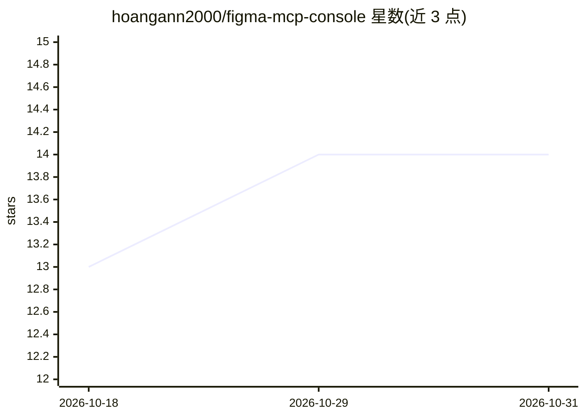

# hoangann2000/figma-mcp-console

⭐ 14 · Go · MIT · 推送 2026-08-24 · [GitHub](https://github.com/hoangann2000/figma-mcp-console) · [官网](https://www.npmjs.com/package/figma-mcp-console) · 个人维护

**让 AI 助手通过 MCP 实时读写 Figma 的本地服务器**

MCP 服务器，通过本地桥接（端口 2000）与 Figma Desktop 开发插件通信，使 AI 客户端无需 Figma API token 即可读写设计文件。功能包括：按 Figma 链接实现界面并导出图标/图片到代码项目、按需求描述在 Figma 中绘制界面并截图自检、设计 token 同步、批量图层编辑。支持 Claude、Cursor、Copilot、Codex 等 MCP 客户端，通过 npx 运行，需 Node.js 18+、Figma Desktop 与手动导入插件。多个 Figma 文件与多个项目会话可共享同一本地桥。

## 筛选速览

| 维度 | 判定 | 备注 |
|---|---|---|
| AI 角色 | `ai-ecosystem` | LLM/agent 周边工具 |
| 许可风险 | `permissive` | MIT |
| 部署形态 | `desktop` | 安装包/桌面程序 |
| 模型依赖 | locked-api |  |
| 硬件要求 | — | 无带数字的原话,不猜 |
| 安装摩擦 | `low` | 无编译、无系统依赖或容器化 |
| 成熟度 | — | 结构信号不足 |

## 能力要点

- 免 Figma API token、无速率限制的本地桥接架构
- Figma→Code 按链接实现界面并导出真实图标与图片
- Requirement→Figma 按需求绘制界面并截图自检修正
- 单桥多文件/多项目：通过 file 参数跨文件操作

## 适用场景

- 把 Figma 设计稿交给 AI 在代码项目中实现
- 让 AI 根据需求描述直接在 Figma 里画界面
- 在 Figma 与代码之间同步设计 token / 设计系统

## 场景标签

 · 领域:开发工具/设计-代码集成

## 证据(README 行号)

> L7: > **Let your AI assistant design in Figma — no API token, no rate limits.**
> L12: - 🖥️ **Figma → Code** — paste a link to a Figma frame, and the AI implements that exact screen in your codebase, ex
> L119: Standard MCP stdio transport — any client works. Set the command to `npx` with args `["-y", "figma-mcp-console@lat

## 星数曲线

2026-10-18 13 → 2026-10-31 14（+1）

---
*卡片 v1 · prompt 1.4 · 生成 2026-10-31 · 置信度 high · 依据 README sha `cbeac866ea70` · [字段定义](../../DATASET.md)*
