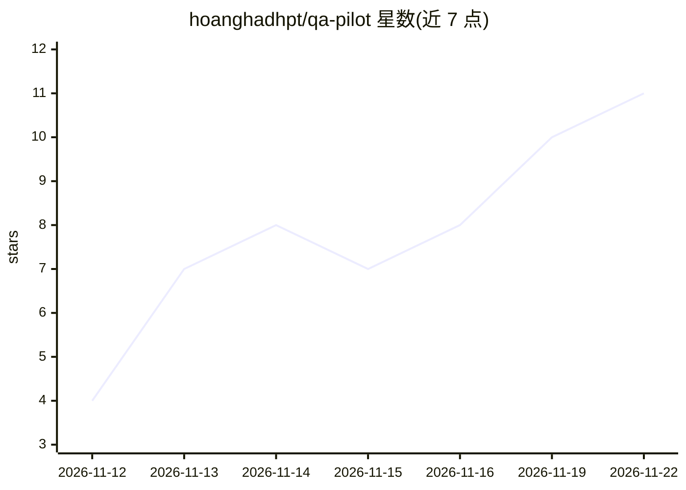

# hoanghadhpt/qa-pilot

⭐ 11 · TypeScript · MIT · 推送 2026-11-12 · [GitHub](https://github.com/hoanghadhpt/qa-pilot) · 个人维护 · 中文 README

**MCP 服务器：让 AI 编码助手执行 Web 自动化测试**

QA Pilot 通过 MCP 协议将 Antigravity IDE、Claude Code、Cursor 等 AI 编码助手接入 Playwright 与 Midscene 视觉引擎，提供导航、操作、断言、会话管理、测试套件生成与执行等 12 个 MCP 工具。观测层覆盖 UI、Console 与 Network 三路信号，会话以 storageState 文件本地存储并解析 JWT 过期时间，测试套件以 YAML 形式存入 Git 仓库并可导出为 Playwright TypeScript 代码。以 npm 包分发，Node >=18.3.0，无外部数据库依赖。

## 筛选速览

| 维度 | 判定 | 备注 |
|---|---|---|
| AI 角色 | `ai-ecosystem` | LLM/agent 周边工具 |
| 许可风险 | `permissive` | MIT |
| 部署形态 | `library` | 以包/库形式分发 |
| 模型依赖 | locked-api |  |
| 硬件要求 | — | 无带数字的原话,不猜 |
| 安装摩擦 | `low` | 无编译、无系统依赖或容器化 |
| 成熟度 | — | 结构信号不足 |

## 能力要点

- Triple-Oracle 观测：UI + Console 异常 + HTTP 网络错误同时校验
- 12 个 MCP 工具覆盖导航/断言/会话/套件生成/报告/代码导出
- AI 生成 5 维测试套件：Happy Path、边界值、负向校验、安全探测、幂等性
- 本地离线启发式词典检索（xss/sql_injection/BVA 等），不消耗 LLM token

## 适用场景

- 让 Claude Code/Cursor 直接驱动浏览器执行 Web 端到端测试
- 自动生成并运行带标签过滤的 YAML 测试套件
- 保存登录会话供不同角色复用，跳过重复 UI 登录
- 将 YAML 套件导出为 Playwright TypeScript 规范文件入库

## 场景标签

`浏览器自动化` `编码 Agent` · 领域:效率与自动化

## 证据(README 行号)

> L3: > **Agentic AI Web Testing Platform powered by Model Context Protocol (MCP), Midscene.js & Playwright**
> L19: **QA Pilot** biến trợ lý AI của bạn (Google Antigravity IDE, Claude Code, Cursor) thành một **Kỹ sư QA Automation c
> L131: **QA Pilot** transforms your AI coding assistant (Google Antigravity IDE, Claude Code, Cursor) into an elite **Sen

## 星数曲线

2026-11-12 4 → 2026-11-22 11（+7）

---
*卡片 v1 · prompt 1.4 · 生成 2026-11-19 · 置信度 high · 依据 README sha `b0052155f465` · [字段定义](../../DATASET.md)*
