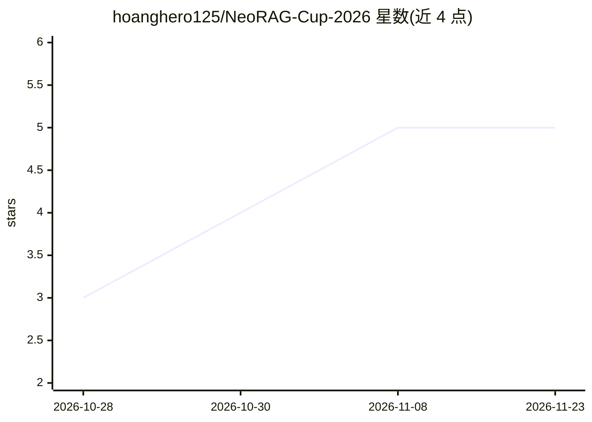

# hoanghero125/NeoRAG-Cup-2026

⭐ 5 · Python · NOASSERTION · 推送 2026-11-07 · [GitHub](https://github.com/hoanghero125/NeoRAG-Cup-2026) · [官网](https://bit.ly/neorag2026) · 组织维护

**PTIT 编程社团 Team AI 举办的 RAG 竞赛资料包**

面向 ProPTIT 社团内部成员的 RAG 竞赛（2026-10-19 至 11-09）配套仓库：提供关于 S2B 三个社团（ProPTIT/MPC/GCC）问答任务的语料数据、baseline pipeline、官方评分器与示例 chatbot。参赛者需提交完整 RAG pipeline、在官方系统上完成 Public/Private Test 提交、构建问答界面并做现场演示。评分按 Benchmark 40%、Pitching 25%、Technical 20%、Demo 15% 加权，统一使用组委会 gateway 提供的 claude-haiku 模型。

## 筛选速览

| 维度 | 判定 | 备注 |
|---|---|---|
| AI 角色 | `ai-knowledge` | 知识聚合/清单类 |
| 许可风险 | `permissive` | NOASSERTION |
| 部署形态 | `None` |  |
| 模型依赖 | — | README 未给出锁定关系 |
| 硬件要求 | — | 无带数字的原话,不猜 |
| 安装摩擦 | `low` | 无编译、无系统依赖或容器化 |
| 成熟度 | — | 结构信号不足 |

## 能力要点

- 提供竞赛语料、baseline pipeline、官方评分器与示例 chatbot
- 统一经由组委会 gateway 以个人 key 访问 claude-haiku 模型
- 评分同时衡量检索质量与回答质量，以 baseline 阈值折算分数
- 赛程含 Public Test、Private Test 与现场 Pitching 三个阶段

## 适用场景

- 参加 NeoRAG Cup 2026 的参赛者搭建 RAG 问答系统
- 查阅竞赛规则、评分标准与提交流程
- 参考官方 baseline 与示例 chatbot 理解任务要求

## 场景标签

`RAG` `模型评测` · 领域:评测与运维

## 证据(README 行号)

> L5: NeoRAG Cup 2026 là cuộc thi nội bộ do Team AI – CLB Lập Trình PTIT tổ chức. Thí sinh thiết kế và triển khai một hệ t
> L7: Repository này cung cấp bộ dữ liệu, pipeline baseline, bộ chấm chính thức và một chatbot mẫu để tham khảo. Hướng dẫn

## 星数曲线

2026-10-28 3 → 2026-11-23 5（+2）

---
*卡片 v1 · prompt 1.4 · 生成 2026-11-21 · 置信度 high · 依据 README sha `8689eb539c6e` · [字段定义](../../DATASET.md)*
