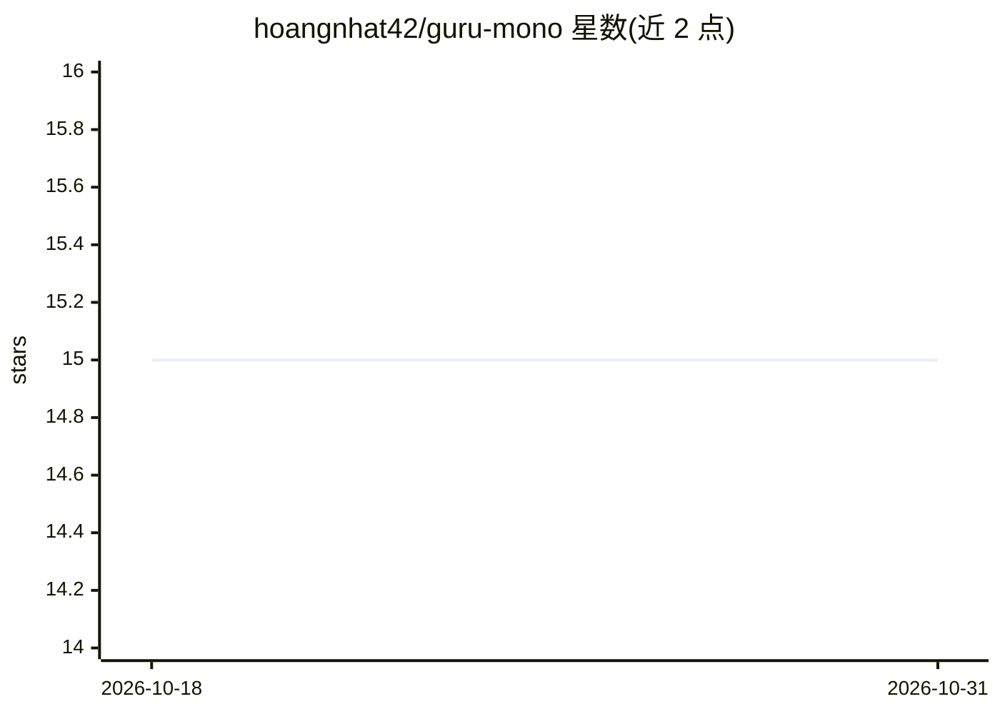

# hoangnhat42/guru-mono

⭐ 15 · TypeScript · MIT · 推送 2026-08-12 · [GitHub](https://github.com/hoangnhat42/guru-mono) · 个人维护

**自托管 AI 全栈开发工作台：用自然语言生成 React/Go 应用**

自托管的全栈 AI 开发工作区：用户在聊天中描述应用，审阅生成的规格说明，再通过集成编辑器、控制台与实时预览操作生成结果。生成的项目采用 React 前端、可选 Go API 与独立 PostgreSQL schema。架构含 React/Vite 工作区、Go/Gin 控制面、FastAPI AI 编排服务（LiteLLM/OpenRouter、pgvector），项目在 Docker 沙箱中运行。要求 OpenRouter API key，Go 服务挂载 Docker socket 执行 AI 生成代码，需运行于隔离可信主机；限制 20 个活跃项目进程与每用户每小时 20 次 LLM 请求。

## 筛选速览

| 维度 | 判定 | 备注 |
|---|---|---|
| AI 角色 | `ai-native` | 本体是模型或模型工具 |
| 许可风险 | `permissive` | MIT |
| 部署形态 | `self-host` | docker 或自建部署 |
| 模型依赖 | locked-api |  |
| 硬件要求 | — | 无带数字的原话,不猜 |
| 安装摩擦 | `low` | 无编译、无系统依赖或容器化 |
| 成熟度 | — | 结构信号不足 |

## 能力要点

- 结构化交付流程：分析、前端、后端、验证四阶段
- 版本化项目规格说明，支持审阅、批准与回滚
- 三级 AI 模型路由（Fast/Default/Premium）按任务复杂度选择
- Monaco 编辑、依赖管理、实时预览与构建错误自动恢复

## 适用场景

- 在自托管环境中通过对话生成 React/Go 全栈应用
- 审阅并版本化管理 AI 生成的项目规格与代码
- 在 Docker 沙箱中预览和导出生成的应用

## 场景标签

`代码生成` · 领域:编码与开发

## 证据(README 行号)

> L6: GURU is a self-hosted AI full-stack development workspace. A user describes an
> L8: result in an integrated editor, console, and live preview. Generated projects
> L26: - Automatic build-error recovery and tiered AI model routing

## 星数曲线

2026-10-18 15 → 2026-10-31 15（+0）

---
*卡片 v1 · prompt 1.4 · 生成 2026-10-30 · 置信度 mid · 依据 README sha `26958f37519e` · [字段定义](../../DATASET.md)*
