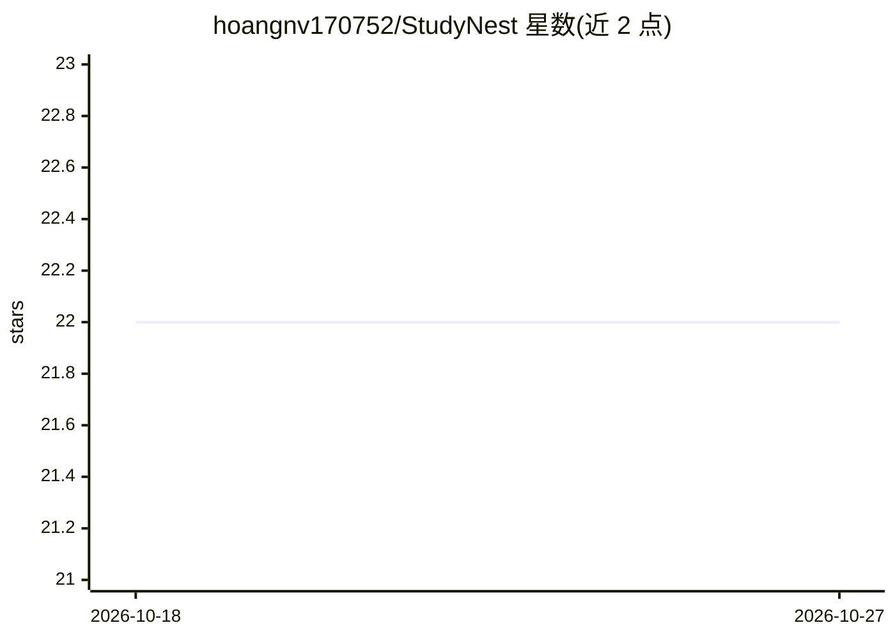

# hoangnv170752/StudyNest

⭐ 22 · Rust · 推送 2026-07-04 · [GitHub](https://github.com/hoangnv170752/StudyNest) · 个人维护

**本地离线运行 LLM 的桌面学习助手，数据不出设备**

基于 Electron+React+TypeScript 的桌面学习助手应用，提供对话界面、多会话管理、提示模板与明暗主题。本地运行 LLM 有两种方式：内置的 Rust/Crane 服务（运行 Qwen2.5/Qwen3 系列模型，支持 Apple Silicon Metal 与 NVIDIA CUDA 加速），或连接外部服务（Ollama/LM Studio/llama.cpp 的本地端点）。数据全部保存在设备上，无需外部 API。需 Node.js、pnpm 与 Rust 工具链从源码构建运行，无预编译安装包。

## 筛选速览

| 维度 | 判定 | 备注 |
|---|---|---|
| AI 角色 | `ai-native` | 本体是模型或模型工具 |
| 许可风险 | `none` | — |
| 部署形态 | `library` | 以包/库形式分发 |
| 模型依赖 | local-ok | 支持本地模型 |
| 硬件要求 | — | 无带数字的原话,不猜 |
| 安装摩擦 | `medium` | 含编译或系统依赖之一 |
| 成熟度 | — | 结构信号不足 |

## 能力要点

- 内置 Rust/Crane 服务本地运行 Qwen2.5/Qwen3 小模型，无需外部服务器
- 可切换连接 Ollama、LM Studio、llama.cpp 等外部本地推理服务
- 离线优先，所有数据留在设备，不发起外部 API 调用
- Apple Silicon Metal 与 NVIDIA CUDA GPU 加速支持

## 适用场景

- 在没有网络或注重隐私的环境下用本地模型辅助学习与研究
- 在桌面端管理多个本地 LLM 对话并保存历史
- 用小参数模型在普通配置电脑上跑本地问答

## 场景标签

`AI 助手` · 领域:对话与助手

## 证据(README 行号)

> L3: An AI-powered study assistant desktop application that runs locally with privacy-first design. Built with Electron, 
> L28: - Support for local Small Language Models (SLM)
> L42: - All data stays on your device

## 星数曲线

2026-10-18 22 → 2026-10-27 22（+0）

---
*卡片 v1 · prompt 1.4 · 生成 2026-10-27 · 置信度 mid · 依据 README sha `f5f2ed49f915` · [字段定义](../../DATASET.md)*
